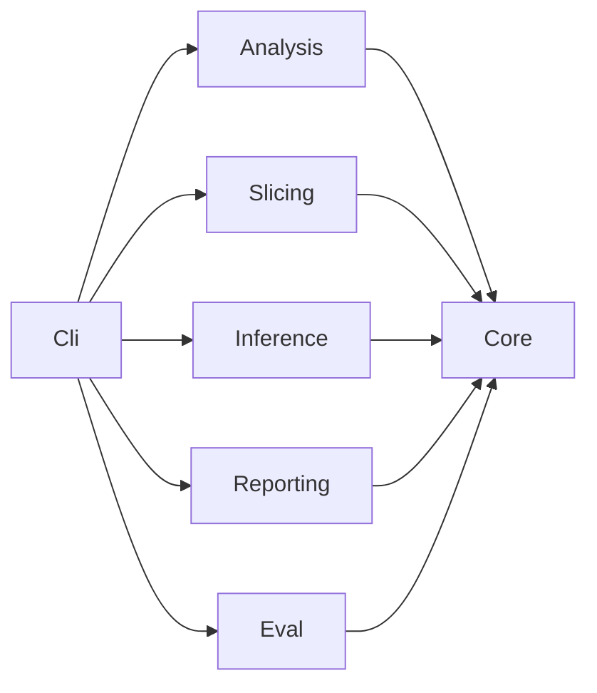

# BolaLens — Automated Context-Aware BOLA Detection in ASP.NET Core Web APIs

[](https://github.com/LasaKaru/Final_Year_Project/actions/workflows/ci.yml)

Final-year project (IIT 20223087 | UoW W19598693) · Supervisor: Ms. Pudara Dewdini

BolaLens is an **offline**, three-stage static analyser that finds **horizontal, state-changing Broken Object Level
Authorization (BOLA)** in ASP.NET Core + EF Core Web APIs:

1. **Roslyn symbolic engine** — endpoint inventory, global policy map, EF Core ownership schema, DI resolution and an
   inter-procedural taint walker that follows a client-controlled route/body id through controller → service → repository
   to EF Core updates/deletes, checks guards, and gives a three-state verdict (Vulnerable / Protected / Unknown) with rule IDs.
2. **Local SLM validation** — a label-free IR slice of each candidate path is judged by a local ONNX model
   (Phi-3-mini via ONNX Runtime GenAI); its grounded JSON verdict is fused with the symbolic verdict.
3. **Reporting** — `report.json` (findings, spans, reasons, coverage, run metadata), console summary, CI exit codes,
   and an evaluation harness (confusion matrix, precision/recall/F1/FPR/FDR).

> Built on **.NET 8** (`net8.0`, ADR-001). .NET 8 reached end of support on 10 Nov 2026; switching to .NET 10 is one line in
> `Directory.Build.props` plus `global.json`.

## Quick start

```bash
dotnet build BolaLens.sln -c Release
dotnet build fixtures/BolaLab/BolaLab.sln          # the analysed target must be restored
dotnet run --project src/BolaLens.Cli -c Release -- inventory fixtures/BolaLab/BolaLab.sln
dotnet run --project src/BolaLens.Cli -c Release -- scan fixtures/BolaLab/BolaLab.sln --mode symbolic --out report.json
dotnet run --project src/BolaLens.Cli -c Release -- eval --report report.json --labels fixtures/BolaLab/expected.json
dotnet test BolaLens.sln --filter "Category!=RequiresModel"
```

Hybrid mode needs a local model: see [`models/README.md`](models/README.md), then `scan … --mode hybrid`.

## Commands

| Command | Purpose |
|---|---|
| `inventory <path>` | Load a .sln/.slnx/.csproj; list projects, TFMs, documents, compile errors, workspace diagnostics |
| `endpoints <path> [--out]` | Endpoint inventory JSON (verb, route, parameters + binding, id-like, `[Authorize]`) |
| `policy <path> [--out]` | Global authentication/authorization policy map JSON |
| `schema <path> [--out]` | EF Core ownership schema JSON (entities, keys, owner candidates, query filters) |
| `di <path> [--out]` | DI registration map (service → implementations) |
| `paths <path> [--endpoint "PUT api/orders/{id}"] [--out]` | Annotated execution paths + symbolic verdicts |
| `slice <path> --endpoint … [--prompt]` | The label-free IR slice (and the full prompt) |
| `scan <path> --mode symbolic\|hybrid [--config] [--out] [--model]` | Full pipeline → `report.json` + console summary |
| `eval --report r.json --labels l.json [--out metrics.md]` | Metrics; a hybrid report gives both arms (ablation) |

Exit codes: `0` no Vulnerable findings · `1` Vulnerable findings present (CI gating; `--no-fail` disables) · `2` load/usage error.
All heuristics (identity sources, owner-name patterns, depth, model settings) are in [`bolalens.json`](bolalens.json) (`--config`).

## Symbolic rules (first match per sink; a path's verdict is its worst sink)

| Order | Rule | Condition | Verdict |
|---|---|---|---|
| 1 | SYM-01 | no state-changing sink, tracked id not lost in unresolved code | OutOfScope |
| 2 | SYM-02 | no state-changing sink, but the id entered unresolved/ambiguous/too-deep code | Unknown |
| 3 | SYM-03 | valid owner equality or LINQ owner predicate (caller identity ↔ owner property ↔ same object, before the change) | Protected |
| 4 | SYM-05 | resource-based `AuthorizeAsync(User, entity, …)` gates the change | Protected (delegated → SLM candidate) |
| 5 | SYM-06 | loaded with `IgnoreQueryFilters()` and no valid guard | Vulnerable |
| 6 | SYM-07 | detached write from a client key, or bulk write without owner predicate/filter | Vulnerable |
| 7 | SYM-04 | applicable query filter at the required owner level | Protected |
| 8 | SYM-09 | changed entity has no owner candidate | Unknown |
| 9 | SYM-08 | owned entity selected by client id is changed with no valid guard or filter | Vulnerable |

## Preliminary result (development set — not a research result)

`fixtures/BolaLab` is a deliberately vulnerable API with 16 labelled cases (TC01–TC16, labels only in
[`expected.json`](fixtures/BolaLab/expected.json)). Symbolic-only, 2026-11-19
([run](eval/runs/2026-11-19-symbolic-bolalab/metrics.md)): **16/16 units correct with the expected rule IDs**
(TP 9, FP 0, FN 0, TN 6, TC10 correctly Unknown), 4.2 s, 209 MB peak. Because the rules were developed on BolaLab these numbers
show correctness on the fixtures only; generalisation is measured on datasets A/B/C. The hybrid arm has not yet been run
with a real model.

## Architecture

Pipeline (pipes-and-filters) inside a layered solution. `Core` has no Roslyn types; only `Cli` wires things together;
`Inference` never sees Roslyn (it gets an `IrSlice`). Swapping `OnnxSemanticValidator` for `NullSemanticValidator` is the ablation.



| Project | Responsibility |
|---|---|
| `src/BolaLens.Core` | Records (endpoints, policy, schema, paths, sinks, guards, verdicts, report), config, JSON options |
| `src/BolaLens.Analysis` | Stage 1: loading, endpoints, policy, schema, DI, taint walker, EF classifier, guards, rules, pipeline |
| `src/BolaLens.Slicing` | Stage 2a: IR slices, prompt v1 (embedded), few-shot examples from `fixtures/Calibration` |
| `src/BolaLens.Inference` | Stage 2b: ONNX Runtime GenAI generator/validator, response parser, fusion policy |
| `src/BolaLens.Reporting` | Stage 3: JSON report, console summary, finding IDs, coverage manifest |
| `src/BolaLens.Eval` | Labels, unit matching, confusion matrix, metrics, Markdown tables |
| `src/BolaLens.Cli` | `bolalens` commands and the scan service (composition root) |
| `tests/*` | Unit tests on in-memory compilations, BolaLab golden/integration tests, inference/eval tests |
| `fixtures/BolaLab`, `fixtures/Calibration` | Test API (own solution, never deployed) and few-shot calibration code |
| `eval/` | Dataset registry/search log, frozen labels, splits, recorded runs |
| `docs/` | ADRs, requirements status, diagrams, known limitations, reproducibility, logs |

More: [ADRs](docs/adr) · [requirements status](docs/requirements.md) · [known limitations](docs/known-limitations.md) ·
[reproducibility](docs/reproducibility.md) · [diagrams](docs/diagrams) · [AI-use log](docs/ai-log.md).

## Safety

BolaLens only parses and type-checks the analysed code — it never executes it — and runs fully offline (no network code in
`src/`; the model runs locally with no tools). BolaLab is deliberately vulnerable: never deploy it.
