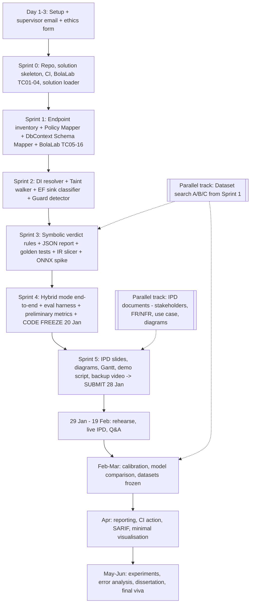

# 00 — START HERE: BOLA Detector Build & IPD Guide Pack

**Project:** Automated Context-Aware BOLA Detection in ASP.NET Core Web APIs
**Student:** Lasantha Karunarathne (IIT 20223087 | UoW W19598693) — Supervisor: Ms. Pudara Dewdini
**Pack written:** 18 November 2026 (Wednesday)
**Hard deadline:** IPD submission to IIT **Thursday 28 January 2027**; live demo + Q&A between **29 Jan – 19 Feb 2027**

> Working name for the tool in this pack: **BolaLens**. Rename it if you like — just use one name everywhere (repo, namespaces, slides).

---

## 1. Where you are right now (honest baseline)

| Area | Status on 18 Nov 2026 |
|---|---|
| Proposal, literature (94 papers), gap analysis, methodology, 4 diagrams | ✅ Done |
| Source code, GitHub repo, tests | ❌ Nothing yet — **starting from zero** |
| Datasets A/B/C | ❌ No case admitted yet |
| Formal FR/NFR list, stakeholder onion, use case diagram | ❌ Not yet (required by IPD) |
| Ethics form Part A | ⚠️ Incomplete (section 2.3, Q1–26 answers, supervisor signature) |
| Schedule | ⚠️ PP timeline puts the IPD demo in Feb–Mar; the real IPD deadline is 28 Jan |

**What the IPD will judge:** actual working software, a GitHub repo, a live demo, source-code walkthrough, updated requirements/design/schedule, and your ability to defend it for 20+ minutes. Diagrams alone **fail** the "meaningful implementation progress" test.

---

## 2. The one-line strategy

> **Build the Roslyn symbolic engine first (it is the backbone and the ablation baseline), prove it on a purpose-built vulnerable test API (BolaLab, TC01–TC16), then bolt on a working local-SLM path on a few slices — and freeze a demo-able version on 20 January.**

At the IPD you will show:

- ✅ **Completed:** solution loading, endpoint inventory, policy map, EF Core ownership schema, DI resolution, ID taint tracking to EF Core sinks, guard detection, symbolic verdicts (Vulnerable / Protected / Unknown), JSON report, automated tests, CI.
- 🔶 **In progress:** IR slicing + local ONNX SLM validation (working end-to-end on fixtures, not yet calibrated), first real open-source repo run, dataset admission.
- ⬜ **Not started:** dashboard / visualisation, full 3-dataset experiments, robustness perturbations, dissertation chapters 4–6.

That is exactly the "Completed / In Progress / Not Yet Started" split the IPD guideline asks for.

---

## 3. Reading order of this pack

| # | File | Read when | What it gives you |
|---|---|---|---|
| 00 | `00_START_HERE.md` | Now | Strategy, first 72 hours, flow |
| 01 | `01_MASTER_PLAN_AND_TIMELINE.md` | Now | Whole-year plan, sprint calendar, Gantt, milestones, risks |
| 02 | `02_SPRINT_BACKLOG_DETAILED.md` | Start of every sprint | Every task with ID, hours, steps, acceptance criteria |
| 03 | `03_ENVIRONMENT_SETUP_GUIDE.md` | Day 1–2 | Install tools, create repo, scaffold the solution command by command |
| 04 | `04_SOLUTION_ARCHITECTURE_AND_STRUCTURE.md` | Day 2–3 | What the .NET solution must contain: projects, folders, packages, data models, contracts |
| 05 | `05_IMPLEMENTATION_GUIDE.md` | Each component | How to build each component in Roslyn / ONNX, with code skeletons and algorithms |
| 06 | `06_TEST_FIXTURES_BOLALAB.md` | Sprint 0–1 | The vulnerable test API, TC01–TC16, expected labels |
| 07 | `07_DATASET_ACQUISITION_GUIDE.md` | From Sprint 1 (parallel track) | How to find, admit and label datasets A/B/C |
| 08 | `08_REQUIREMENTS_AND_STAKEHOLDERS.md` | Sprint 1–2 (doc track) | Consolidated FR/NFR, onion model, use case diagram source |
| 09 | `09_IPD_PRESENTATION_AND_DEMO_GUIDE.md` | Sprint 3 onward | Slide-by-slide outline, demo script, design artefacts, Q&A bank |
| 10 | `10_WORKFLOW_GIT_AND_AI_LOG.md` | Day 1, then daily | Git rules, commit style, weekly log, supervisor minutes, AI-use log |
| 11 | `11_BUILD_FLOW_STEP_BY_STEP.md` | Every coding session | Ordered, file-by-file build list (Phase 0 → 23) with checkpoints and commit messages |

---

## 4. Overall flow (what feeds what)



---

## 5. Your first 72 hours (18–20 November)

Do these **in order**. Tick them off.

### Today — Wednesday 18 Nov (≈3 h)
- [ ] Read `01_MASTER_PLAN_AND_TIMELINE.md` fully (30 min).
- [ ] Send the supervisor email (template in `10_WORKFLOW_GIT_AND_AI_LOG.md §6`). Ask: (1) meeting slot this week, (2) exactly what is uploaded on 28 Jan (slides? report? video? repo link?), (3) OK to move the tool to .NET 10 LTS, (4) ethics form sign-off.
- [ ] Check Blackboard (6COSC023C) for the IPD submission instructions and save them into `docs/ipd/` later.
- [ ] Create a GitHub account check: 2FA on, SSH key or GitHub CLI login works.
- [ ] Start the AI-use log (`docs/ai-log.md`) — first entry: "Used Claude to produce the project plan and guide pack, 18 Nov 2026".

### Thursday 19 Nov (≈3 h)
- [ ] Follow `03_ENVIRONMENT_SETUP_GUIDE.md` §1–§3: install .NET 10 SDK, IDE, Git, Python (for model download only).
- [ ] Verify: `dotnet --info` shows SDK 10.0.x.
- [ ] Create the private GitHub repo `bolalens`, clone it.

### Friday 20 Nov (≈3 h)
- [ ] Follow `03` §4–§6: scaffold the solution with the exact commands, add `Directory.Build.props`, `Directory.Packages.props`, `global.json`, `.editorconfig`.
- [ ] Push. Add the CI workflow. See the green tick on GitHub.
- [ ] First commit message example: `chore: scaffold BolaLens solution (net10.0) with CI`.

By Sunday 29 Nov (end of Sprint 0) you must be able to run:

```bash
dotnet run --project src/BolaLens.Cli -- inventory fixtures/BolaLab/BolaLab.sln
```

and see BolaLab's projects, documents and **0 compile errors**. That is your first real milestone.

---

## 6. Weekly rhythm (part-time friendly)

Assumed capacity: **~18–20 hours/week** (adjust the sprint backlog if yours differs).

| Day | Activity |
|---|---|
| Mon | Plan the week: pick tasks from the sprint backlog, move them to "In progress" on the GitHub board |
| Tue–Fri evenings | 2–3 h coding blocks; commit at least once per session |
| Sat | Long block (5–6 h): hardest task of the week |
| Sun | 1 h: update weekly log, AI log, push, write next week's 3 priorities. Every 2nd Sunday = sprint review (see `10` §5) |

**Rule:** never end a session with uncommitted work. Your commit history is evidence of ownership at the IPD.

---

## 7. Key decisions already made in this pack (defend these at the IPD)

| ID | Decision | Why |
|---|---|---|
| ADR-001 | Tool targets **.NET 10 (LTS)**, not .NET 8 | .NET 8 & 9 reached end of support on 10 Nov 2026; .NET 10 supported to Nov 2028. Analysed target projects can still be .NET 8/9/10. |
| ADR-002 | **CLI-first**; dashboard moved to April and reduced to "Could" | IPD needs working analysis, not UI; the PP itself listed CLI-first as the cheaper prototype path |
| ADR-003 | Three-state verdict **Vulnerable / Protected / Unknown** | From your Oct review: unresolved evidence must not become "safe" |
| ADR-004 | SLM only validates **symbolic candidates** (same candidate set) | Makes RQ2 ablation fair (hybrid vs symbolic-only on identical units) |
| ADR-005 | Purpose-built fixture API **BolaLab** with 16 labelled cases | Historical .NET CVEs are scarce; fixtures give deterministic regression tests and IPD evidence |
| ADR-006 | Expected labels stored in `expected.json`, **never as code comments** | Comments would leak labels into the SLM prompt |
| ADR-007 | Greedy decoding + JSON validation + retry-once → else Unknown | Repeatability and failure transparency |

Write each one as a short file in `docs/adr/` (template in `10` §4). Examiners love seeing *why*.

---

## 8. "IPD-ready" definition (check on 20 January)

- [ ] Public-to-supervisor GitHub repo with README, ≥ 60 meaningful commits, CI green.
- [ ] `bolalens scan` produces a JSON report on BolaLab; symbolic verdicts match expected labels on ≥ 12 of 16 cases (and you can explain every miss).
- [ ] `bolalens scan --mode hybrid` runs a local ONNX model on at least the BolaLab candidates and writes parsed JSON verdicts.
- [ ] `bolalens eval` prints a confusion matrix + precision/recall/F1/FPR for symbolic vs hybrid on BolaLab.
- [ ] Scan has been attempted on ≥ 1 real open-source ASP.NET Core + EF Core repo (results, failures and Unknowns recorded).
- [ ] Runtime + peak memory measured for both modes.
- [ ] Slides, diagrams, Gantt, FR/NFR tables with status, stakeholder onion, use case diagram ready.
- [ ] Demo rehearsed 3× within time; backup screen recording exists.
