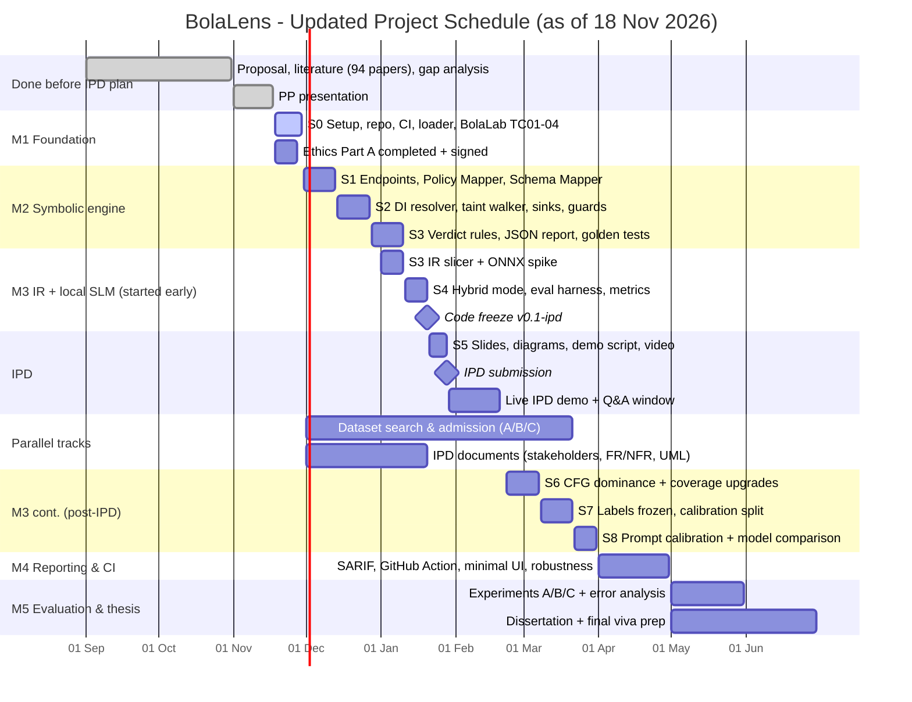

# 01 — Master Plan & Timeline (Nov 2026 → Jun 2027)

This replaces the PP schedule. It is built backwards from the **real IPD deadline (28 Jan 2027)** and keeps the PP's five milestones (M1–M5) so you can show the examiner exactly how the plan changed and why.

---

## 1. Fixed dates

| Date | Event | Source |
|---|---|---|
| Wed 18 Nov 2026 | Plan baseline (this pack) | — |
| Wed 20 Jan 2027 | **Code freeze** for IPD (tag `v0.1-ipd`) | Self-imposed |
| **Thu 28 Jan 2027** | **IPD submission deadline (IIT)** | IPD details doc |
| 29 Jan – 19 Feb 2027 | Live presentation + demo (20 min) + Q&A (~20 min, extendable) | IPD details doc |
| Jun 2027 (confirm) | Final dissertation + final viva | PP timeline — **confirm exact date with supervisor** |

> ⚠️ Confirm on Blackboard what "IPD submission" contains (slides only? slides + repo link? video?). The plan assumes slides + repo link + any requested document.

---

## 2. Sprint calendar (two-week sprints, part-time ~18–20 h/week)

| Sprint | Dates | Theme | Capacity* | Exit milestone |
|---|---|---|---|---|
| **S0** | Wed 18 Nov – Sun 29 Nov | Foundation: tools, repo, solution skeleton, CI, BolaLab TC01–TC04, solution loader | ~30 h | `inventory` command works on BolaLab |
| **S1** | Mon 30 Nov – Sun 13 Dec | Context extraction: endpoint inventory, Policy Mapper, DbContext Schema Mapper, BolaLab TC05–TC16 | ~38 h | `policy`, `schema`, `endpoints` JSON exports correct on BolaLab |
| **S2** | Mon 14 Dec – Sun 27 Dec | Path extraction: DI resolver, taint walker, EF sink classifier, guard detector | ~30 h (holidays) | `paths` JSON shows route-ID → sink paths with guards for all TCs |
| **S3** | Mon 28 Dec – Sun 10 Jan | Symbolic verdict + reporting + IR slicing + ONNX spike | ~34 h | `scan --mode symbolic` passes golden tests; one slice through Phi-3 locally |
| **S4** | Mon 11 Jan – Wed 20 Jan | Hybrid end-to-end, eval harness, preliminary metrics, real-repo run, perf measurement | ~28 h | **Code freeze `v0.1-ipd`** |
| **S5** | Thu 21 Jan – Thu 28 Jan | IPD artefacts: slides, diagrams, Gantt, demo script, backup video | ~22 h | **Submit 28 Jan** |
| IPD window | Fri 29 Jan – Fri 19 Feb | Rehearsals, Q&A prep, bug fixes on a branch only | ~10 h/wk | IPD delivered |
| **S6** | Mon 22 Feb – Sun 7 Mar | Precision upgrades: CFG dominance, IEntityTypeConfiguration, minimal-API (if time) | | |
| **S7** | Mon 8 Mar – Sun 21 Mar | Dataset admission complete, labels frozen, calibration split | | **Labels frozen 21 Mar** |
| **S8** | Mon 22 Mar – Wed 31 Mar | Prompt calibration, model comparison (Phi-3-mini vs Phi-4-mini vs Qwen2.5-Coder) | | M3 done |
| **S9–S10** | 1 Apr – 30 Apr | Reporting: SARIF, HTML/minimal React view, GitHub Action, robustness perturbations | | M4 done |
| **S11–S14** | 1 May – Jun | Full experiments on A/B/C, error analysis, dissertation, final viva prep | | M5 done |

\*Capacity is a planning assumption. If you have less time, cut from the "Could" items in `02`, **never** from tests or the symbolic engine.

---

## 3. Gantt chart (paste into any Mermaid renderer — e.g. mermaid.live — for the IPD slide)

---

## 4. PP schedule vs updated schedule (use this table on the "deviations" slide)

| PP milestone (Oct 2026 version) | PP dates | Updated | Change & reason |
|---|---|---|---|
| M1 Foundation & ethics, Roslyn loader | Oct–Nov | 18 Nov – 29 Nov | Coding start slipped ~6 weeks because Oct was spent on a deeper 94-paper review that changed the novelty claim and design (Unknown state, EF bypass cases, metric corrections). |
| M2 Symbolic engine | Dec–Jan | 30 Nov – 10 Jan | Compressed into 3 sprints; DI resolution bounded to depth 5. |
| M3 IR + SLM + "IPD demo" | Feb–Mar | **Started 1 Jan**, partial by 20 Jan; completed by 31 Mar | PP put the IPD demo in M3, but the IPD is 28 Jan. A thin vertical slice of M3 (one model, fixtures only) is pulled forward so the IPD shows the hybrid working. |
| M4 Reporting, CI, minimal dashboard | Apr | Apr (unchanged) | Dashboard reduced to "Could"; SARIF + GitHub code-scanning view added as the cheaper explainability surface. |
| M5 Experiments, dissertation | May–Jun | May–Jun (unchanged) | Labels frozen earlier (21 Mar) to protect evaluation validity. |
| Tool runtime | .NET 8/9 | **.NET 10 LTS** | .NET 8/9 end of support 10 Nov 2026. |

---

## 5. Milestone deliverables & evidence

| Milestone | Deliverable | Evidence you can show |
|---|---|---|
| M1 (29 Nov) | Repo, CI, solution skeleton, BolaLab v1, loader | Green CI badge, `inventory` output, first ADRs |
| M2a (13 Dec) | Context extraction | `endpoints.json`, `policy.json`, `schema.json` for BolaLab + unit tests |
| M2b (27 Dec) | Path extraction | `paths.json` with route→service→sink chains, guards, spans |
| M2c (10 Jan) | Symbolic detector | Golden tests TC01–TC16, `report.json`, symbolic-only baseline = ablation arm |
| M3-thin (20 Jan) | Hybrid prototype | IR slices, SLM JSON verdicts, fusion, eval table, timing/RAM, tag `v0.1-ipd` |
| IPD (28 Jan) | Presentation pack | Slides, UML set, Gantt, FR/NFR status, demo video |
| M3 (31 Mar) | Calibrated hybrid | Frozen labels, calibration report, model comparison table |
| M4 (30 Apr) | Integration | SARIF in GitHub code scanning, Action workflow, minimal view, robustness tests |
| M5 (Jun) | Research result | Experiment logs, metrics on A/B/C, error taxonomy, dissertation |

---

## 6. Parallel tracks (do a little every week)

### Track P1 — Datasets (start S1, 2–3 h/week)
Detailed in `07_DATASET_ACQUISITION_GUIDE.md`.
- S1: build search log; screen GitHub Advisory DB (NuGet ecosystem) and NVD for IDOR/authorization CWEs.
- S2: shortlist 10–15 open-source ASP.NET Core + EF Core APIs for Dataset B; check build.
- S3–S4: admit ≥ 1 real repo for the IPD demo run; draft labels on ≥ 10 endpoints.
- Feb–Mar: complete admission; freeze labels by **21 Mar**.

### Track P2 — IPD documents (start S1, 1–2 h/week)
Detailed in `08` and `09`.
- S1: stakeholder onion + table.
- S2: consolidated FR/NFR list with MoSCoW, mapping to PP IDs.
- S3: use case diagram, component + class + sequence + activity diagrams (update as code evolves).
- S4: status column (Implemented / Partial / Pending) filled from real code; preliminary results table.

### Track P3 — Dissertation notes (30 min/week)
Keep `docs/thesis-notes.md`: design decisions, problems hit, how you solved them. This becomes Chapter "Implementation" and the IPD "Critical evaluation" slide for free.

---

## 7. Risk register (updated for the build phase)

| ID | Risk | L / I | Early warning sign | Mitigation | Fallback |
|---|---|---|---|---|---|
| R1 | MSBuildWorkspace fails to load real projects (SDK mismatch, missing restore) | M / H | Workspace diagnostics, 0 documents | Run `dotnet restore` first; pin SDK with `global.json`; `MSBuildLocator.RegisterDefaults()` first line | Analyse per `.csproj`; record as coverage failure |
| R2 | Inter-procedural taint explosion / missed DI targets | M / H | Paths > 1000 or many Unknowns | Depth bound 5; method summaries cache; DI registration map | Report Unknown with reason (that is a valid result) |
| R3 | No usable historical .NET BOLA CVEs | H / M | 0 admitted after S2 | Start search S1; broaden CWE set; patch-diff search | Clearly separated reconstructed cases + BolaLab; narrow claim |
| R4 | Local SLM too slow / invalid JSON | M / M | > 60 s per slice, parse failures | int4 CPU model, short slices, greedy, early-stop at `}` | SLM limited to ranking/explanations; report negative result honestly |
| R5 | Not enough time (part-time + holidays) | H / H | Sprint velocity < 70 % two sprints running | Weekly priorities; "Must" first; demo freeze 20 Jan | Drop "Could" items; IPD shows SLM spike only |
| R6 | Cannot explain own code in Q&A | M / H | Copy-pasted code you can't explain | Type skeletons yourself; write a 3-line comment per class; rehearse walkthrough | — (must not happen) |
| R7 | Laptop/hardware failure before demo | L / H | — | Push daily; backup video; model hash recorded | Demo from recording + repo |
| R8 | Label leakage into prompts | M / M | Comments/names reveal answers | `expected.json` separate; strip comments from slices; perturbation tests | — |
| R9 | Ethics form not signed | L / M | No reply in 1 week | Raise in first supervisor meeting | Escalate to module leader |

---

## 8. Supervisor cadence

- **Bi-weekly** meeting at the end of each sprint (S0 review ~27 Nov, S1 ~11 Dec, S2 ~23 Dec or early Jan, S3 ~8 Jan, S4 ~20 Jan).
- Send a **one-page sprint report** the day before (template `10` §5): done / not done / blockers / demo link / next sprint goal.
- Ask for a **mock IPD** in the week of 21–27 Jan.

---

## 9. Priority rules when time runs short

1. Symbolic engine correctness on BolaLab > anything else.
2. Tests and reproducibility > new features.
3. One working SLM path > comparing several models.
4. Honest Unknowns > clever heuristics that hide failures.
5. A plain JSON + console report > any dashboard before the IPD.
