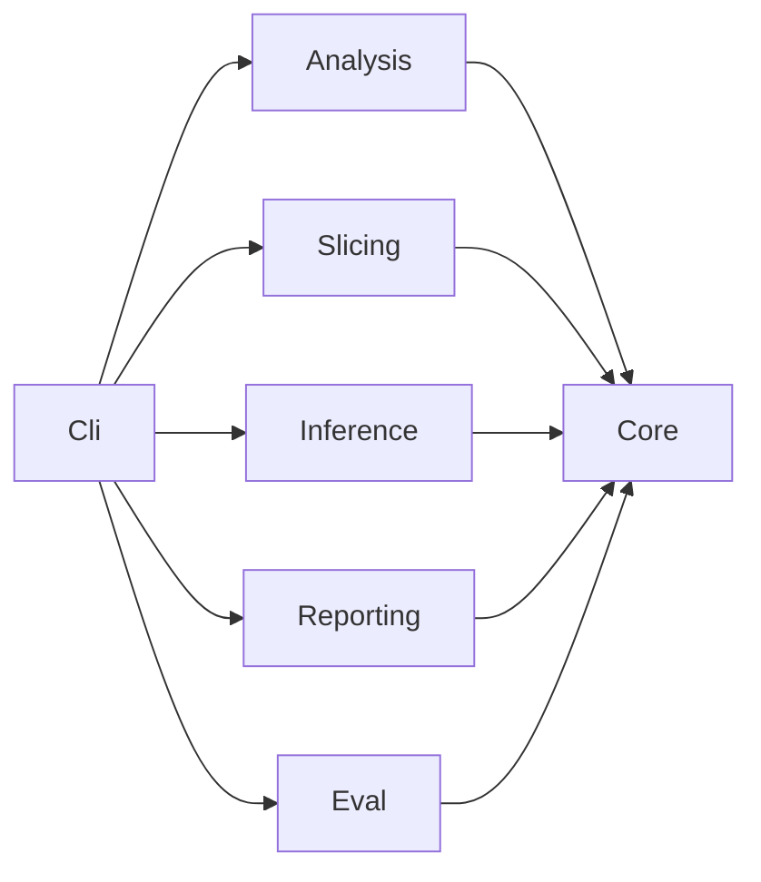
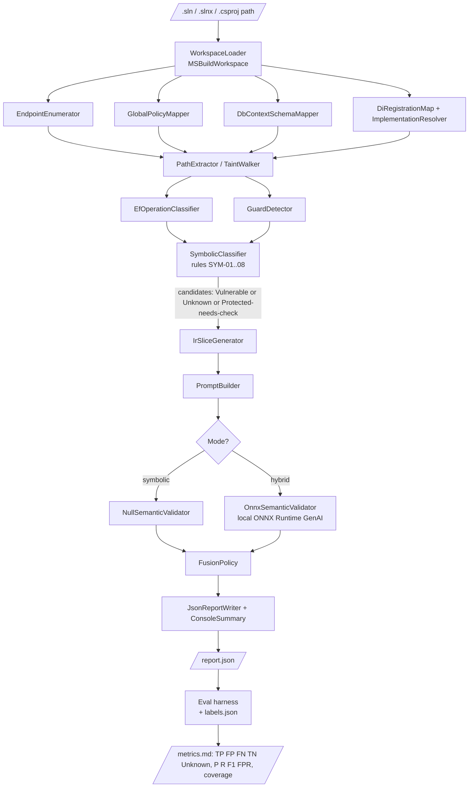

# 04 — Solution Architecture & Structure (what the .NET solution must contain)

This is the blueprint of the repository. If the examiner opens your GitHub repo, this is what they should see and what you should be able to explain folder by folder.

---

## 1. Repository tree (target state at the IPD)

```
bolalens/
├── .github/workflows/ci.yml              # build + test + smoke scan
├── global.json                           # SDK pin (10.0.x, rollForward latestFeature)
├── Directory.Build.props                 # net10.0, nullable, deterministic, version
├── Directory.Packages.props              # central NuGet versions (pinned)
├── .editorconfig  .gitignore  README.md  LICENSE (MIT or "All rights reserved" - ask supervisor)
├── BolaLens.sln
├── bolalens.json                         # default analysis config (identity sources, owner patterns)
│
├── src/
│   ├── BolaLens.Core/                    # pure domain: records, enums, interfaces, JSON options. NO Roslyn.
│   │   ├── Model/        SourceRef.cs, EndpointInfo.cs, PolicyMap.cs, OwnershipSchema.cs,
│   │   │                 ExecutionPath.cs, Guard.cs, Sink.cs, Verdicts.cs, Finding.cs, ScanReport.cs
│   │   ├── Config/       AnalysisOptions.cs, BolaLensConfig.cs
│   │   ├── Abstractions/ ISemanticValidator.cs, IReportWriter.cs, IClock.cs
│   │   └── Json/         JsonDefaults.cs
│   │
│   ├── BolaLens.Analysis/                # Stage 1 - Roslyn symbolic engine
│   │   ├── Loading/      MsBuildBootstrap.cs, WorkspaceLoader.cs, LoadedSolution.cs
│   │   ├── Endpoints/    EndpointEnumerator.cs, RouteTemplate.cs, BindingInference.cs
│   │   ├── Policy/       GlobalPolicyMapper.cs
│   │   ├── Schema/       DbContextSchemaMapper.cs, OwnerCandidateInference.cs
│   │   ├── DI/           DiRegistrationMap.cs, ImplementationResolver.cs
│   │   ├── Taint/        TaintState.cs, TaintWalker.cs, PathExtractor.cs, CallerIdentityRecognizer.cs
│   │   ├── Sinks/        EfOperationClassifier.cs
│   │   ├── Guards/       GuardDetector.cs
│   │   ├── Verdict/      SymbolicClassifier.cs, SymbolicRules.cs
│   │   └── Pipeline/     SymbolicPipeline.cs   # orchestrates Stage 1
│   │
│   ├── BolaLens.Slicing/                 # Stage 2a - IR slice generation + prompt building
│   │   ├── IrSliceGenerator.cs, IrSlice.cs, SourceMap.cs, TokenEstimator.cs
│   │   └── Prompting/    PromptBuilder.cs, FewShotExamples.cs, prompt-v1.txt (embedded resource)
│   │
│   ├── BolaLens.Inference/               # Stage 2b - local SLM
│   │   ├── OnnxSemanticValidator.cs      # Microsoft.ML.OnnxRuntimeGenAI
│   │   ├── NullSemanticValidator.cs      # symbolic-only mode (ablation)
│   │   ├── SemanticResponseParser.cs     # JSON extraction + schema + evidence check
│   │   └── FusionPolicy.cs               # symbolic x semantic -> final verdict
│   │
│   ├── BolaLens.Reporting/               # Stage 3
│   │   ├── JsonReportWriter.cs, ConsoleSummaryRenderer.cs
│   │   ├── FindingIdFactory.cs, CoverageManifestBuilder.cs
│   │   └── Sarif/  SarifReportWriter.cs  # post-IPD (M4)
│   │
│   ├── BolaLens.Eval/                    # evaluation harness (research instrument)
│   │   ├── LabelSet.cs, UnitMatcher.cs, ConfusionMatrix.cs, Metrics.cs, MarkdownTable.cs
│   │
│   └── BolaLens.Cli/                     # composition root + commands
│       ├── Program.cs
│       └── Commands/ InventoryCommand.cs, EndpointsCommand.cs, PolicyCommand.cs, SchemaCommand.cs,
│                     PathsCommand.cs, SliceCommand.cs, ScanCommand.cs, EvalCommand.cs
│
├── tests/
│   ├── BolaLens.Analysis.Tests/          # fast unit tests on in-memory compilations
│   │   ├── Infrastructure/CompilationFactory.cs
│   │   └── EndpointEnumeratorTests.cs, GlobalPolicyMapperTests.cs, SchemaMapperTests.cs,
│   │       DiResolverTests.cs, TaintWalkerTests.cs, GuardDetectorTests.cs, SymbolicRulesTests.cs
│   ├── BolaLens.Integration.Tests/       # full pipeline on BolaLab (MSBuildWorkspace)
│   │   └── BolaLabGoldenTests.cs (+ *.verified.json snapshots)
│   └── BolaLens.Inference.Tests/         # parser/fusion tests (no model) + [Trait("Category","RequiresModel")] tests
│
├── fixtures/
│   ├── Directory.Build.props             # empty - stops inheritance
│   ├── Directory.Packages.props          # CPM off
│   └── BolaLab/                          # deliberately vulnerable test API (own solution)
│       ├── BolaLab.sln
│       ├── expected.json                 # ground truth for TC01-TC16 (never as code comments)
│       └── src/BolaLab.Api/ ...
│   └── Calibration/                      # 3-6 tiny separate examples used for few-shot prompts (S3)
│
├── eval/
│   ├── datasets/  registry.csv, search-log.md, admission-checklist.md
│   ├── labels/    <repo-id>.labels.json  # frozen ground truth per repo
│   ├── splits/    calibration.txt, heldout.txt
│   └── runs/      <date>-<mode>-<target>/ report.json, metrics.md, env.md   (raw/ is git-ignored)
│
├── models/README.md                      # how to download, SHA-256 hashes, licence (models git-ignored)
├── playground/                           # Roslyn kata (S0-06) - not part of the product
└── docs/
    ├── adr/ ADR-001 ... ADR-00N.md
    ├── diagrams/ *.mmd, *.puml, *.drawio, exported *.png
    ├── ipd/ submission-requirements.md, slides/, demo-script.md, qa-bank.md
    ├── ethics/ (redacted copy)
    ├── ai-log.md  weekly-log.md  supervisor-meetings.md  thesis-notes.md
    ├── known-limitations.md  reproducibility.md
```

---

## 2. Architectural style & dependency rules

**Style:** pipeline (pipes-and-filters) inside a layered solution. Each stage consumes immutable records produced by the previous stage. This is easy to test, easy to explain, and makes the **ablation** trivial (swap `OnnxSemanticValidator` for `NullSemanticValidator`).



Rules (put these in README → "Architecture"):
1. `Core` depends on nothing (except BCL). It contains *no* Roslyn types — Roslyn objects never leave `Analysis`/`Slicing`; they are converted to `SourceRef` + strings.
2. Only `Cli` wires things together (composition root).
3. `Inference` knows nothing about Roslyn or `Slicing`; it receives an `IrSliceText` (slice text + valid line IDs, a record defined in `Core`) and returns a `SemanticVerdict`.
4. Every stage output is serialisable to JSON — so you can inspect any intermediate step from the CLI (`endpoints`, `policy`, `schema`, `paths`, `slice`). This is gold for the demo and Q&A.

---

## 3. Runtime pipeline (data flow)



---

## 4. Responsibilities per component (one-liners for your slides)

| Component | Input | Output | Key Roslyn/.NET API |
|---|---|---|---|
| WorkspaceLoader | path | `Solution` + load diagnostics | `MSBuildLocator`, `MSBuildWorkspace` |
| EndpointEnumerator | `Compilation` | `EndpointInfo[]` | `INamedTypeSymbol`, `AttributeData`, `IParameterSymbol` |
| GlobalPolicyMapper | Program.cs/Startup | `PolicyMap` | `IInvocationOperation`, `IAnonymousFunctionOperation` |
| DbContextSchemaMapper | DbContext classes | `OwnershipSchema` | `IPropertySymbol`, `HasQueryFilter` lambda operations |
| DiRegistrationMap / ImplementationResolver | Program.cs + solution | interface→impl map | `IInvocationOperation` type args, `SymbolFinder.FindImplementationsAsync` |
| CallerIdentityRecognizer | operation | is-trusted-identity? | `IPropertyReferenceOperation`, `IInvocationOperation` |
| TaintWalker / PathExtractor | endpoint + method bodies | `ExecutionPath[]` | `SemanticModel.GetOperation`, `OperationWalker` |
| EfOperationClassifier | invocation | `SinkInfo` / `QueryInfo` | `IMethodSymbol.ContainingNamespace` |
| GuardDetector | path operations | `GuardEvidence[]` | `IConditionalOperation`, `IBinaryOperation`, `IReturnOperation`, `IThrowOperation` |
| SymbolicClassifier | path + schema + policy | `SymbolicVerdict` (+ rule IDs) | — (pure C#) |
| IrSliceGenerator | path | `IrSlice` (tagged lines + source map) | `SyntaxNode.ToString()`, line spans |
| PromptBuilder | slice + few-shot | prompt string | — |
| OnnxSemanticValidator | prompt | `SemanticVerdict` | `Model`, `Tokenizer`, `GeneratorParams`, `Generator` |
| FusionPolicy | symbolic + semantic | `FinalVerdict` | — |
| JsonReportWriter | findings | `report.json` | `System.Text.Json` |
| Eval | report + labels | confusion matrix + metrics | — |

---

## 5. Core data model (C# records — put in `BolaLens.Core/Model`)

Type these yourself; they are your "class diagram".

```csharp
namespace BolaLens.Core.Model;

public sealed record SourceRef(string FilePath, int StartLine, int EndLine, string? Snippet = null);

public enum HttpVerb { Get, Post, Put, Patch, Delete, Unknown }
public enum BindingSource { Route, Body, Query, Header, Service, Unknown }

public sealed record ParameterInfo(string Name, string Type, BindingSource Source, bool IsIdLike, string? IdPropertyPath = null);

public sealed record AuthorizeInfo(bool HasAuthorize, bool AllowAnonymous, IReadOnlyList<string> Policies, IReadOnlyList<string> Roles);

public sealed record EndpointInfo(
    string Id,                       // e.g. "PUT api/orders/{id}"
    HttpVerb Verb,
    string RouteTemplate,
    string Controller,
    string Action,
    string ActionSymbol,             // fully-qualified method display string
    IReadOnlyList<ParameterInfo> Parameters,
    AuthorizeInfo Authorization,
    SourceRef Location);

public sealed record PolicyDefinition(string Name, IReadOnlyList<string> Requirements, SourceRef Location);

public sealed record ResourceHandlerInfo(string HandlerType, string RequirementType, string ResourceType, SourceRef Location);

public sealed record PolicyMap(
    IReadOnlyList<string> AuthenticationSchemes,
    bool FallbackRequiresAuthenticatedUser,
    bool GlobalAuthorizeFilter,
    IReadOnlyList<PolicyDefinition> Policies,
    IReadOnlyList<ResourceHandlerInfo> ResourceHandlers,   // AuthorizationHandler<TReq, TResource> classes
    IReadOnlyList<UnresolvedItem> Unresolved);

public enum OwnerKind { User, Tenant, Organisation, Unknown }
public enum OwnerEvidence { NamePattern, ForeignKeyToUserType, QueryFilter, Configured }

public sealed record OwnerCandidate(string Property, OwnerKind Kind, IReadOnlyList<OwnerEvidence> Evidence);

public sealed record QueryFilterInfo(string Expression, IReadOnlyList<string> ReferencedProperties, OwnerKind ScopeKind, SourceRef Location);

public sealed record EntityModel(
    string EntityType,               // "BolaLab.Api.Domain.Order"
    string DbContext,
    string? DbSetName,
    IReadOnlyList<string> KeyProperties,
    IReadOnlyList<OwnerCandidate> OwnerCandidates,
    IReadOnlyList<QueryFilterInfo> QueryFilters);

public sealed record OwnershipSchema(IReadOnlyList<EntityModel> Entities, IReadOnlyList<UnresolvedItem> Unresolved);

public sealed record UnresolvedItem(string Reason, SourceRef? Location);

// ---------- Paths ----------
public enum StepKind { Source, Assignment, Call, Load, Mutation, Guard, Sink, Commit, Unresolved }

public sealed record PathStep(StepKind Kind, string Description, string? Symbol, SourceRef Location);

public enum SinkKind { Read, Update, Remove, Attach, SaveChanges, BulkUpdate, BulkDelete, Unknown }

public sealed record SinkInfo(
    SinkKind Kind,
    string EntityType,
    bool IsStateChanging,
    bool BypassesQueryFilters,       // IgnoreQueryFilters on the loading query
    bool IsDetached,                 // entity constructed from request data (new T { Id = id })
    bool QueryHasOwnerPredicate,     // e.g. Where(o => o.Id == id && o.UserId == uid)
    string Symbol,
    SourceRef Location);

public enum GuardKind { OwnerEquality, LinqOwnerPredicate, ResourceAuthorization, QueryFilter, Unknown }

public sealed record GuardEvidence(
    GuardKind Kind,
    bool IsValid,                    // binds trusted caller + same object + owner property
    string? InvalidReason,           // "untrusted comparand", "different object", "does not precede sink"
    string? OwnerProperty,
    string? CallerExpression,
    SourceRef Location);

public sealed record ExecutionPath(
    string Id,
    EndpointInfo Endpoint,
    ParameterInfo TaintSource,
    IReadOnlyList<PathStep> Steps,
    IReadOnlyList<SinkInfo> Sinks,
    IReadOnlyList<GuardEvidence> Guards,
    IReadOnlyList<UnresolvedItem> Unresolved,
    bool Truncated);

// ---------- Verdicts ----------
public enum VerdictStatus { Vulnerable, Protected, Unknown, OutOfScope }

public sealed record SymbolicVerdict(VerdictStatus Status, IReadOnlyList<string> RuleIds, string Rationale);

public sealed record SemanticVerdict(
    VerdictStatus Status,
    double? Confidence,              // model score, NOT a calibrated probability
    string Reason,
    IReadOnlyList<string> EvidenceLineIds, // e.g. ["L3","L7"] - must exist in the slice
    bool ParseOk,
    string ModelId,
    long LatencyMs,
    string? RawOutput);

public sealed record Finding(
    string FindingId,
    ExecutionPath Path,
    SymbolicVerdict Symbolic,
    SemanticVerdict? Semantic,
    VerdictStatus Final,
    string FinalReason);
```

```csharp
public sealed record CoverageManifest(
    int ProjectsLoaded, int ProjectsFailed, int Endpoints, int EndpointsWithIdParams,
    int PathsExtracted, int PathsTruncated, int UnresolvedCalls,
    int SymbolicVulnerable, int SymbolicProtected, int SymbolicUnknown,
    int SemanticParseFailures);

public sealed record RunInfo(
    string ToolVersion, string Mode, string TargetPath, string? TargetCommit,
    string ConfigHash, string? ModelId, string? ModelSha256, string? PromptVersion,
    DateTimeOffset StartedUtc, double TotalSeconds, double? ModelLoadSeconds,
    long PeakWorkingSetBytes, string Machine);

public sealed record ScanReport(RunInfo Run, CoverageManifest Coverage, IReadOnlyList<Finding> Findings, IReadOnlyList<UnresolvedItem> LoadDiagnostics);
```

---

## 6. `report.json` — example shape (what the demo shows)

```json
{
  "run": {
    "toolVersion": "0.1.0",
    "mode": "hybrid",
    "targetPath": "fixtures/BolaLab/BolaLab.sln",
    "modelId": "phi3-mini-4k-instruct-cpu-int4",
    "modelSha256": "…",
    "promptVersion": "v1",
    "totalSeconds": 74.2,
    "modelLoadSeconds": 6.1,
    "peakWorkingSetBytes": 3912384512
  },
  "coverage": { "endpoints": 18, "endpointsWithIdParams": 16, "pathsExtracted": 17, "symbolicUnknown": 1, "semanticParseFailures": 0 },
  "findings": [
    {
      "findingId": "a3f19c02be71",
      "path": {
        "endpoint": { "id": "PUT api/orders/{id}/status", "action": "UpdateStatus", "location": { "filePath": "Controllers/OrdersController.cs", "startLine": 31, "endLine": 44 } },
        "taintSource": { "name": "id", "type": "int", "source": "Route", "isIdLike": true },
        "sinks": [ { "kind": "SaveChanges", "entityType": "Order", "isStateChanging": true, "bypassesQueryFilters": false, "isDetached": false } ],
        "guards": []
      },
      "symbolic": { "status": "Vulnerable", "ruleIds": ["SYM-08"], "rationale": "State-changing sink on Order reached by route id; Order has User owner 'UserId'; no valid owner guard or applicable query filter." },
      "semantic": { "status": "Vulnerable", "confidence": 0.86, "reason": "Order is loaded by id only (L5) and saved (L8) without comparing order.UserId to the caller (L2).", "evidenceLineIds": ["L2","L5","L8"], "parseOk": true, "latencyMs": 8120 },
      "final": "Vulnerable",
      "finalReason": "Symbolic and semantic agree."
    }
  ]
}
```

---

## 7. Configuration file `bolalens.json`

Explicit, documented heuristics = defensible assumptions.

```json
{
  "analysis": {
    "maxCallDepth": 5,
    "includeReadOnlyPaths": false,
    "idParameterPatterns": ["^id$", "Id$", "Key$"]
  },
  "identity": {
    "claimsPrincipalMembers": ["User", "HttpContext.User"],
    "claimAccessMethods": ["FindFirst", "FindFirstValue"],
    "currentUserTypes": [
      { "type": "*.ICurrentUser", "userMembers": ["UserId"], "tenantMembers": ["TenantId"] }
    ],
    "extensionMethods": ["GetUserId", "GetTenantId"]
  },
  "ownership": {
    "userOwnerPatterns": ["^UserId$", "^OwnerId$", "^OwnerUserId$", "^CreatedBy(Id)?$", "^AuthorId$", "^CustomerId$"],
    "tenantOwnerPatterns": ["^TenantId$", "^OrganisationId$", "^OrganizationId$", "^CompanyId$"],
    "userTypeNames": ["User", "ApplicationUser", "AppUser", "IdentityUser"]
  },
  "inference": {
    "modelPath": "models/phi3-mini-4k/cpu_and_mobile/cpu-int4-rtn-block-32-acc-level-4",
    "maxLength": 3072,
    "suppressThreshold": 0.80,
    "retryOnParseFailure": 1
  }
}
```

---

## 8. CLI surface (System.CommandLine)

| Command | Purpose | Sprint |
|---|---|---|
| `bolalens inventory <path>` | Load, list projects/documents/diagnostics | S0 |
| `bolalens endpoints <path> [--out]` | Endpoint inventory JSON | S1 |
| `bolalens policy <path> [--out]` | Global policy map JSON | S1 |
| `bolalens schema <path> [--out]` | Ownership schema JSON | S1 |
| `bolalens paths <path> [--endpoint "PUT api/orders/{id}"] [--out]` | Annotated execution paths | S2 |
| `bolalens slice <path> --endpoint …` | Print the IR slice (and prompt with `--prompt`) | S3 |
| `bolalens scan <path> --mode symbolic\|hybrid [--config] [--out]` | Full pipeline → report.json + console summary | S3/S4 |
| `bolalens eval --report r.json --labels l.json [--out metrics.md]` | Metrics | S4 |

Exit codes: `0` no Vulnerable findings, `1` Vulnerable findings present (lets CI gate a PR), `2` load/usage error.

---

## 9. Naming & coding conventions

- Namespaces mirror folders: `BolaLens.Analysis.Taint`.
- One public type per file. `sealed` by default. Records for data, classes for behaviour.
- Every analyser class has a **3-line XML doc comment**: what it does, its input, its known limitation. (You will be asked.)
- No static mutable state except `MsBuildBootstrap`.
- All `async` methods take a `CancellationToken`.
- Never swallow exceptions silently: convert to `UnresolvedItem` with a reason.
- Logging: `Microsoft.Extensions.Logging` console logger in Cli; `--verbose` flag.

---

## 10. Mapping solution ↔ PP requirements (traceability for the IPD)

| PP ID | Requirement | Where in the solution |
|---|---|---|
| F1 | Ingest solutions, build compilations | `Analysis/Loading` |
| F2 | Global Policy Map | `Analysis/Policy` |
| F3 | EF Core ownership schema | `Analysis/Schema` |
| F4 | Taint paths route → EF sinks | `Analysis/DI`, `Analysis/Taint`, `Analysis/Sinks`, `Analysis/Guards`, `Analysis/Verdict` |
| F5 | IR slices with metadata | `Slicing` |
| F6 | Local ONNX SLM, structured output | `Inference` |
| F7 | JSON reporting + visual dashboard | `Reporting` (JSON now; SARIF/HTML/React later) |
| N1 | Offline | No HTTP client anywhere in `src/`; offline run evidence |
| N2 | < 30 min CI | `RunInfo.TotalSeconds`, CI smoke scan |
| N3 | FPR reduction | `Eval` + `NullSemanticValidator` ablation |
| N4 | Explainability | `SourceRef`, rule IDs, `EvidenceLineIds` |
| D1–D3, E1–E2 | Datasets & metrics | `eval/`, `BolaLens.Eval` |
