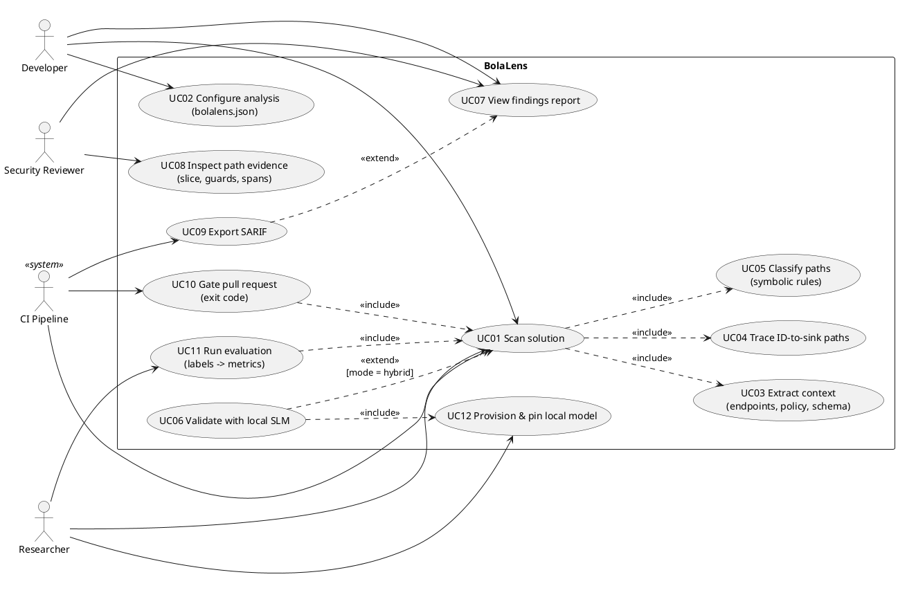

# 08 — Stakeholders, Formal Requirements & Use Cases (IPD sections B and C)

Fill the **Status** columns from the *real* code on 20 January — never from this plan. Allowed values: ✅ Implemented · 🔶 Partially implemented · ⬜ Pending.

---

## 1. Stakeholder Onion Model

Draw in draw.io as 4 concentric ellipses (inner → outer). Put each stakeholder as a small labelled shape in its ring; colour = role type (blue functional beneficiary, green operational, orange regulatory/academic, red negative).

| Ring | Stakeholders |
|---|---|
| **1. The system** | BolaLens (CLI analyser + local SLM + reports) |
| **2. The containing system (operational / kit)** | Application developer (primary operator) · Security reviewer / AppSec engineer (triage) · DevOps / CI pipeline owner · Researcher-operator (you, running experiments) |
| **3. The containing business** | Engineering team lead / product owner · Organisation's security & compliance officer · Project supervisor (Ms. Pudara Dewdini) · IIT / University of Westminster examiners |
| **4. The wider environment** | End users of scanned APIs (data owners) · Open-source maintainers of analysed projects · Regulators/data-protection law (e.g. GDPR) · Research community · SAST/DAST tool vendors (competitors) · Model & framework providers (Microsoft: .NET, Roslyn, ONNX Runtime, Phi licences) · **Attackers (negative stakeholder)** |

## 2. Stakeholder table (roles, interests, expectations, influence)

| Stakeholder | Role | Interest / expectation | Influence on requirements |
|---|---|---|---|
| Application developer | Runs scans locally/in PR | Few false alarms; exact file/line; quick | FR13 source-anchored findings, NFR02 runtime, NFR04 explanations |
| Security reviewer | Triages findings | Evidence of *why* (guards, filters, owner fields); Unknowns visible | FR09 three-state verdict, FR12 rule IDs, NFR07 failure transparency |
| DevOps / CI owner | Integrates in pipelines | Deterministic exit codes, JSON/SARIF, no network | FR16 CI gating, NFR01 offline, NFR06 determinism |
| Researcher-operator (you) | Builds & evaluates | Ablation switch, reproducible runs, metrics | FR17 eval harness, FR11 symbolic/hybrid modes, NFR05 reproducibility |
| Team lead / product owner | Funds adoption | Low cost, no code leaves premises | NFR01, NFR08 commodity hardware |
| Compliance officer | Data/privacy | Source code not sent to third parties; licences respected | NFR01, NFR11 |
| Supervisor | Academic guidance | Feasible scope, rigorous evaluation, ownership | Scope narrowing; CLI-first; dashboard → Could |
| Examiners | Assessment | Working prototype, justified design, honest results | Status tracking, demo-ability |
| End users of APIs | Indirect beneficiaries | Their records cannot be modified by others | Focus on state-changing horizontal BOLA |
| OSS maintainers | Owners of analysed code | Responsible disclosure, fair reporting | Disclosure process, pattern-level reporting |
| Research community | Readers/replicators | Benchmark, protocol, negative results reported | Labels/splits published, coverage + Unknowns reported |
| Model/framework providers | Licensors | Licence compliance | Model card + licence recorded |
| Attackers (negative) | Misuse | Want exploitable leads | No exploit generation; defensive output only |

**How stakeholder input changed the project since the PP** (put on the slide):
- Supervisor/PP feedback + October review → narrowed novelty claim, added *Unknown*, added EF bypass/detached/bulk cases.
- Developer/CI perspective → CLI + JSON + exit codes first; SARIF planned (shows in GitHub UI) instead of a heavy dashboard before the IPD.
- Compliance perspective → strict offline proof (network-disabled run) added as an acceptance test.

---

## 3. Functional requirements (consolidated; PP IDs mapped)

Priority = MoSCoW. "IPD target" is the plan; fill "Status" from reality.

| ID | Requirement | Pri | PP ID | IPD target | Status |
|---|---|---|---|---|---|
| FR01 | Load a .sln/.slnx/.csproj via MSBuildWorkspace and report load/compile diagnostics | Must | F1 | ✅ | |
| FR02 | Enumerate controller endpoints: verb, route, parameters + binding source, ID-like params, [Authorize]/[AllowAnonymous] | Must | F1 | ✅ | |
| FR03 | Build a Global Policy Map (schemes, fallback/default, named policies, global filters, resource handlers) | Must | F2 | ✅ | |
| FR04 | Infer EF Core ownership schema (DbSets, keys, owner candidates User/Tenant, query filters incl. IEntityTypeConfiguration) | Must | F3 | ✅ (config classes 🔶) | |
| FR05 | Resolve DI interface calls to implementations; mark ambiguous/external dispatch as Unresolved | Must | F4 | ✅ | |
| FR06 | Trace route/body IDs across controller → service → repository to EF Core operations (bounded depth) | Must | F4 | ✅ | |
| FR07 | Classify EF operations: load, write, commit, bulk, bypass (IgnoreQueryFilters), detached | Must | F4 | ✅ | |
| FR08 | Detect guards (owner equality, LINQ owner predicate, resource authorization, query filter) and validate binding | Must | F4 | ✅ (dominance 🔶) | |
| FR09 | Produce symbolic verdict Vulnerable / Protected / Unknown / OutOfScope with rule IDs | Must | F4 | ✅ | |
| FR10 | Generate label-free IR slices with source map and token estimate | Must | F5 | ✅ | |
| FR11 | Validate candidates with a local ONNX SLM; parse/ground JSON; select symbolic or hybrid mode | Must | F6 | 🔶 (uncalibrated) | |
| FR12 | Fuse symbolic and semantic verdicts with a configurable threshold | Should | F6 | 🔶 | |
| FR13 | Write JSON report (findings, spans, reasons, coverage manifest, run info) + console summary | Must | F7 | ✅ | |
| FR14 | Export SARIF 2.1.0 for GitHub code scanning | Should | F7 (new) | ⬜ | |
| FR15 | CI integration: exit codes + GitHub Actions workflow | Should | F7 | 🔶 (exit codes ✅, action ⬜) | |
| FR16 | Visualise paths (HTML report or minimal React view) | Could | F7 | ⬜ | |
| FR17 | Evaluation harness: match predictions to frozen labels; confusion matrix, P/R/F1/FPR/FDR, coverage | Must | E1 | ✅ | |
| FR18 | Configuration file for identity sources, owner patterns, depth, model settings | Should | new | ✅ | |
| FR19 | Inspect intermediate artefacts via CLI (endpoints, policy, schema, paths, slice) | Should | new | ✅ | |
| FR20 | Minimal-API endpoint support | Could | new | ⬜ | |
| FR21 | Robustness perturbation runner (renames, comments, equivalent guards) | Could | new (G6) | ⬜ | |

## 4. Non-functional requirements

| ID | Requirement | Measure / acceptance | PP ID | IPD target | Status |
|---|---|---|---|---|---|
| NFR01 | Offline operation | No network calls in `src/`; full hybrid scan succeeds with network disabled (recorded) | N1 | ✅ evidence | |
| NFR02 | Performance | Medium solution < 30 min end-to-end on 16 GB CPU laptop; report per-phase times | N2 | 🔶 measured on BolaLab + 1 repo | |
| NFR03 | False-positive reduction measured | Hybrid vs symbolic-only FPR/precision on identical units | N3 | 🔶 preliminary (BolaLab only) | |
| NFR04 | Explainability | Each finding has endpoint, source/sink spans, rule ID, reason; SLM evidence lines exist in slice | N4 | ✅ | |
| NFR05 | Reproducibility | SDK, package versions, model SHA-256, prompt version, config hash in every report | new (R8) | ✅ | |
| NFR06 | Determinism | Greedy decoding; 3 repeated runs; differences reported | new | 🔶 | |
| NFR07 | Failure transparency | Unresolved calls, timeouts, parse failures counted in coverage; never silently "safe" | new (R7) | ✅ | |
| NFR08 | Resource budget | Peak memory ≤ 16 GB machine; model int4 CPU | N2 | 🔶 measured | |
| NFR09 | Portability | Runs on Windows and Linux (CI) | new | ✅ | |
| NFR10 | Maintainability | Layered solution, unit + golden tests, CI green; core analysers covered by tests | new | ✅ | |
| NFR11 | Safety of the tool | Treats analysed code as untrusted text; never executes target code; model has no tools/network | new | ✅ | |
| NFR12 | Usability of output | Console summary readable by a developer with basic security knowledge | N4 | 🔶 | |

## 5. Changes to requirements since the PP (justify each)

| Change | Reason |
|---|---|
| Added **Unknown** outcome (FR09, NFR07) | Literature review (Oct): missing evidence must not become a "safe" verdict; needed for honest recall/coverage. |
| FR07 expanded with bypass / detached / bulk writes | EF Core docs: query filters do not protect every write path; key validity threat. |
| React dashboard **Should → Could** (FR16); SARIF added (FR14) | Supervisor/IPD priority on working analysis; SARIF gives in-IDE/GitHub visualisation at low cost. |
| FR17 evaluation harness made explicit | Needed for RQ2 ablation and preliminary IPD results. |
| NFR05/06 reproducibility & determinism added | Measurement requirements from the review (model hash, decoding settings, repeated runs). |
| Runtime: .NET 8/9 → **.NET 10 LTS** for the tool | .NET 8/9 end of support on 10 Nov 2026. Analysed projects may still target 8/9. |
| Novelty statement narrowed | Prior art found (LLM4BOLA, Neo includes C#, Absentia, BACScan/BACFuzz) → contribution = evaluated EF-aware Roslyn + local-SLM combination for .NET. |

## 6. Traceability: objectives ↔ research questions ↔ requirements

| Objective | RQ | Requirements |
|---|---|---|
| O1 Symbolic extraction engine | RQ1 path recovery | FR01–FR09, FR18, FR19, NFR07 |
| O2 IR + local SLM validation | RQ2 SLM contribution, RQ3 cost | FR10–FR12, NFR01, NFR06, NFR08 |
| O3 Reporting & visualisation | RQ4 explanation quality | FR13–FR16, NFR04, NFR12 |
| O4 Empirical benchmarking | RQ1–RQ4 | FR17, FR21, NFR02, NFR03, NFR05 |

---

## 7. Use case diagram (PlantUML source — render at plantuml.com or with the VS Code PlantUML extension)

Colour/annotate use cases by status on the slide (✅/🔶/⬜).

### Use case descriptions (show one in the slides, keep the rest as backup)

**UC01 Scan solution**
| Field | Content |
|---|---|
| Actor | Developer, CI Pipeline, Researcher |
| Pre-conditions | .NET SDK installed; target restored; (hybrid) model provisioned |
| Main flow | 1 user runs `bolalens scan <path> --mode …` · 2 system loads the solution · 3 extracts endpoints/policy/schema · 4 traces paths · 5 classifies with rules · 6 (hybrid) slices + validates with SLM · 7 fuses · 8 writes report + summary · 9 returns exit code |
| Alternatives | 2a load failure → diagnostics in report, exit 2 · 6a model output invalid → retry once → Unknown |
| Post-conditions | `report.json` with findings, coverage manifest, run info |
| Requirements | FR01–FR13, NFR01, NFR02, NFR05, NFR07 |

**UC06 Validate with local SLM** — trigger: candidate path (Vulnerable/Unknown/delegated-Protected); flow: build label-free slice → prompt v1 → greedy generate → parse/ground → fuse; exception: timeout/parse failure → Unknown counted.

**UC11 Run evaluation** — pre: frozen labels; flow: load report + labels → match units → confusion matrix → metrics table; rule: undefined denominators printed as n/a.
