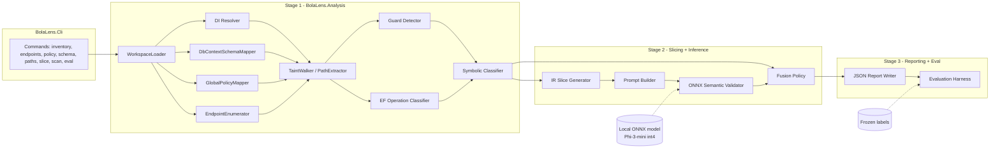
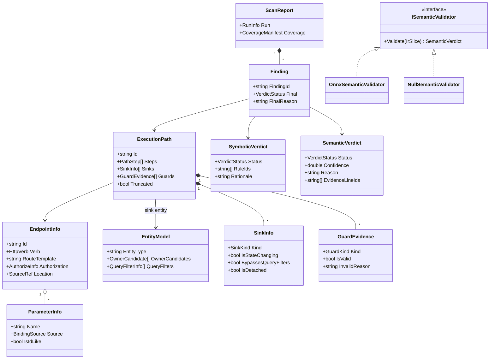
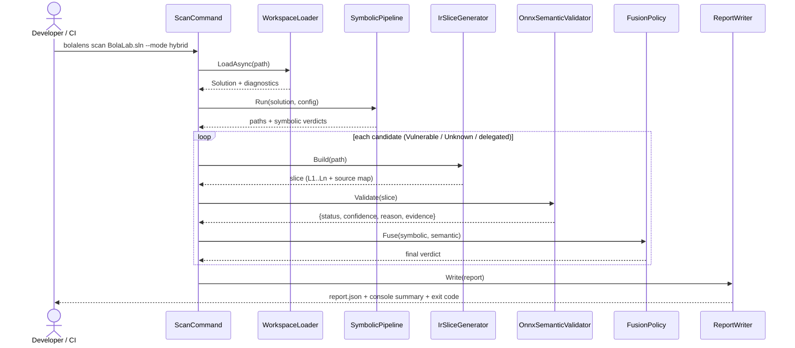
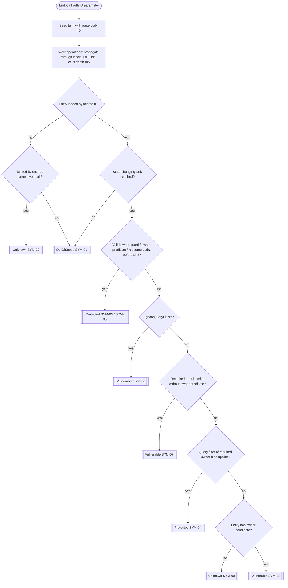
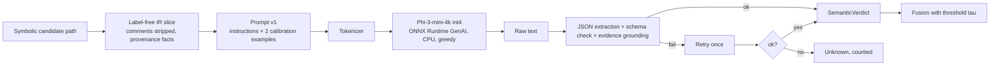

# 09 — IPD Presentation, Design Artefacts, Demo Script & Q&A Bank

Format reminder: **20 minutes total** (presentation ≈ 12 min + live demo ≈ 8 min), then **Q&A ≈ 20 min, may be extended**. Recorded on Teams. Emphasis: what you **actually built** since the PP.

---

## 1. Slide-by-slide outline (17 slides, ~12 min)

| # | Slide | Time | Content (keep text short; diagrams carry the weight) |
|---|---|---|---|
| 1 | Title | 0:15 | Title, name, IDs, supervisor, "Interim Progression Demonstration", date |
| 2 | Problem · aim · solution in one picture | 1:00 | One sentence each + the 3-stage diagram (reuse PP Diagram 1). No re-teaching BOLA. |
| 3 | Progress since PP at a glance | 0:45 | Three columns ✅ Completed / 🔶 In progress / ⬜ Not started (from `00` §2, updated with reality) + repo stats (commits, tests, LOC) |
| 4 | What changed since PP & why | 1:00 | Table from `08` §5 (Unknown state, EF write paths, .NET 10, dashboard → Could, narrowed novelty, TC13–16) |
| 5 | Stakeholder onion | 0:45 | Onion diagram; one line on how stakeholders shaped requirements |
| 6 | Functional requirements + status | 1:00 | FR table (top ~12 rows) with ✅🔶⬜ |
| 7 | Non-functional requirements + status | 0:30 | NFR table with measures |
| 8 | Use case diagram | 0:30 | PlantUML diagram, coloured by status |
| 9 | Architecture (component + data flow) | 1:00 | Component diagram (§3.1); technology stack strip underneath |
| 10 | Core algorithm: ID taint → guard → verdict | 1:15 | Activity diagram (§3.4) + the SYM rule table (compressed) |
| 11 | Data model / class diagram | 0:30 | Class diagram (§3.2) |
| 12 | Hybrid stage: slice → prompt → local SLM → fusion | 0:45 | Sequence diagram (§3.3) + one real slice excerpt |
| 13 | Testing & preliminary results | 1:00 | BolaLab golden tests: x/16 correct; symbolic vs hybrid table (P/R/F1/FPR); runtime/RAM; 1 real repo coverage. Label clearly: *preliminary, development set* |
| 14 | Updated Gantt | 0:45 | Gantt from `01` §3; mark today line; show deviations |
| 15 | Critical evaluation | 1:00 | Achievements · challenges & how solved · limitations · on track? (§5) |
| 16 | Remaining work & milestones | 0:30 | M3 (31 Mar), labels frozen (21 Mar), M4 (Apr), M5 (May–Jun) |
| 17 | Summary → "Now the live demo" | 0:15 | 3 bullets |

Practise until slides 1–17 take **11–12 minutes**.

---

## 2. IPD requirement → where you satisfy it

| IPD requirement | Slide / demo moment |
|---|---|
| Problem, aim, solution; progress since PP; scope changes | 2, 3, 4 |
| Stakeholders (onion), roles, influence | 5 |
| FR/NFR, use case diagram, implemented/partial/pending, changes since PP | 6, 7, 8, 4 |
| Architecture, components, data flow, technologies, design artefacts, algorithms | 9, 10, 11, 12 |
| Updated schedule, deviations, milestones | 14, 16 |
| Critical evaluation, challenges, limitations | 15 |
| GitHub repo & organisation | Demo step 1 |
| Source code walkthrough, important algorithms | Demo steps 2, 5 |
| Completed / partial / not started functionality | Demo steps 3–7 + slide 3 |
| Testing & preliminary results | Demo step 6 + slide 13 |
| AI/ML: model selection, inference pipeline, preliminary evaluation | Slide 12, demo step 5 |

---

## 3. Design artefacts (Mermaid sources — paste into mermaid.live, export SVG/PNG)

### 3.1 Component diagram

### 3.2 Class diagram (core model)

### 3.3 Sequence diagram — `scan --mode hybrid`

### 3.4 Activity diagram — path classification algorithm

### 3.5 AI/ML pipeline diagram (for the "AI/ML evidence" box)

Explain: **no training/fine-tuning** (few-shot in-context only, by design — small .NET dataset, overfitting risk); "dataset preparation" = calibration slices + labelled fixtures; "evaluation" = ablation vs symbolic-only.

---

## 4. Live demo script (target 7–8 min) — run from tag `v0.1-ipd`

### Pre-demo checklist (30 min before)
- [ ] Laptop on power, notifications off, Teams screen-share tested, font size ≥ 16 in terminal & IDE.
- [ ] `git checkout v0.1-ipd`, `dotnet build -c Release` done; BolaLab built; model folder present.
- [ ] Run `scan --mode hybrid` once (warms disk cache; note: report *cold* numbers from your measurement log, not from this run).
- [ ] Tabs pre-opened: GitHub repo, Actions page, Projects board, IDE with `TaintWalker.cs`, `GuardDetector.cs`, `SymbolicRules.cs`, `OnnxSemanticValidator.cs`, BolaLab `OrdersController.cs`.
- [ ] Backup video open in a player, paused at 0:00.
- [ ] Network can be disabled quickly (airplane mode) for the offline proof.

### Script
| Step | Time | Do | Say (key point) |
|---|---|---|---|
| 1 Repo tour | 1:00 | GitHub: README, folder structure, commits graph, Issues/board, CI green, tag | "Layered solution: Core, Analysis = Stage 1, Slicing + Inference = Stage 2, Reporting + Eval = Stage 3. CI builds, tests, and smoke-scans the fixture on every push." |
| 2 The target | 0:45 | IDE: BolaLab `OrdersController` — show TC01 vs TC02 side by side, and `expected.json` | "Ground truth lives outside the code, so labels can't leak into prompts." |
| 3 Context extraction | 1:00 | `bolalens schema …` and `bolalens policy …` | "Order has a User owner; Project only Tenant with a query filter; Note has both — that's why TC11 is still vulnerable." |
| 4 Paths & symbolic scan | 1:30 | `bolalens paths … --endpoint "DELETE api/invoices/{id}"` (TC13, cross-layer), then `bolalens scan … --mode symbolic` → console table | "The ID crosses controller → service → repository; the save is hidden in the repository. Rule SYM-08 fires. Each finding cites rule, spans and invalid guards." |
| 5 Code walkthrough | 1:30 | IDE: `GuardDetector` (binding check) + `SymbolicRules` order | "A guard only counts if it binds trusted identity, the same object and the owner property, before the sink." |
| 6 Hybrid | 1:30 | Airplane mode ON → `bolalens slice … --endpoint "PUT api/orders/{id}/adjust-total"` → `bolalens scan … --mode hybrid` → open report JSON for one finding | "Everything runs locally — network is off. The model gets a label-free slice and must cite line IDs that exist." |
| 7 Tests & results | 0:45 | `dotnet test` summary; `bolalens eval …` metrics table | "Preliminary, on the development fixture only — the research evaluation is on frozen held-out datasets after March." |
| 8 Not yet done | 0:15 | Board "Not started" column | "SARIF, visualisation, calibrated thresholds, full datasets." |

If anything fails live: say what failed, switch to the backup video at the same step, continue. Examiners accept minor errors — they don't accept panic or hiding.

---

## 5. Critical evaluation slide — fill with *real* content

Structure (one line each):
- **Achievements:** e.g. cross-layer taint with DI resolution works on TC13/TC14; EF bypass/detached/bulk modelled; 3-state verdicts; local hybrid end-to-end offline.
- **Challenges → resolution:** e.g. MSBuildLocator load-order crash → bootstrap first; SaveChanges hidden in repository missed → commit summaries; LINQ receiver chains for extension methods → walk `Arguments[0]`; model JSON drift → grounding + retry + Unknown.
- **Methodology/technology changes:** .NET 10; CLI-first; dashboard deferred; Unknown added.
- **Limitations now:** path-insensitive (no CFG dominance yet); minimal APIs unsupported; owner inference is name/FK-based; SLM uncalibrated; BolaLab is development data; only 1 real repo so far.
- **On track?** Honest RAG status per objective (O1 green, O2 amber, O3 amber, O4 amber/red because datasets) + what protects the deadline (labels freeze 21 Mar, Could-items first to drop).

---

## 6. Q&A bank — prepare your own 3–5 line answer for each (S5-06)

**Problem & research**
1. Why is BOLA not detectable by existing .NET SAST? What exactly do they miss?
2. Your review found LLM4BOLA, Neo, Absentia. What is *your* contribution then?
3. Why focus on state-changing, horizontal BOLA only?
4. What is the difference between authentication, function-level and object-level authorization?
5. Why is "a tenant filter exists" not proof of protection? (TC11, IgnoreQueryFilters, detached writes)

**Design & algorithms**
6. Walk me through what happens from `scan` to `report.json`.
7. How do you resolve `IInvoiceService.VoidAsync` to its implementation? What if there are two?
8. How does the taint walker know `order` was selected by the attacker's id?
9. What makes a guard *valid*? Show me the code.
10. How do you handle `if (order.UserId != request.UserId)`? Why is that wrong?
11. Why is your analysis path-insensitive and what errors can that cause? Plan to fix?
12. Why a depth bound of 5? What happens beyond it?
13. Why IOperation instead of syntax walking?
14. How are query filters extracted, including `IEntityTypeConfiguration`?
15. What exactly is in the IR slice and why no comments / no symbolic verdict?

**AI/ML**
16. Why a small local model instead of GPT-class cloud models?
17. Why few-shot instead of fine-tuning/LoRA?
18. How do you stop hallucinated explanations? (grounding of `L#` evidence)
19. Is the confidence a probability? How will τ be chosen without test leakage?
20. What if the SLM suppresses a true vulnerability? How do you measure that?
21. Why Phi-3-mini? What other models will you compare and how?
22. How deterministic is it? What did repeated runs show?
23. How did you prove it runs offline?

**Evaluation**
24. Define precision, recall, F1, FPR, FDR — and why BolaRay's 21.9 % is FDR.
25. Why is BolaLab not valid evidence for your research claim?
26. How do you prevent the tool from defining its own ground truth?
27. How will you split calibration/held-out data? Why by repository family?
28. What if you find only 2 historical .NET cases?
29. Which baseline SAST tool, and is it a fair comparator?
30. What is "operational recall" and why report it?

**Implementation & ownership**
31. Show me where `MSBuildLocator` is registered and why it must be first.
32. What was the hardest bug you fixed? How did you debug it?
33. How do your tests work without a real project? (`CompilationFactory`)
34. What does your CI do?
35. How did you use AI tools in this project? (answer from `docs/ai-log.md`)

**Project management**
36. Why are you behind the PP schedule and how will you recover?
37. What will you drop first if time runs short?
38. What did your supervisor's feedback change?
39. Ethics: is approval needed? What about responsible disclosure?
40. What will be finished by the final submission, realistically?

---

## 7. Slide design rules

- One message per slide; ≤ 6 short lines of text; diagrams ≥ 60 % of slide area.
- Same template as PP but **remove "Project Proposal (PP)" footers** — label "IPD".
- Every figure numbered and captioned ("Figure 3: Component diagram").
- Status colours consistent everywhere: ✅ green / 🔶 amber / ⬜ grey.
- Numbers on slides must match the report files in `eval/runs/` — the examiner may ask to see them.
- Fix PP typos ("Octomber", "Novt", supervisor's name spelling).
- Put the GitHub URL + tag on slide 1 and the last slide.

## 8. Submission checklist (28 Jan)

- [ ] Confirm exact deliverables on Blackboard (`docs/ipd/submission-requirements.md`).
- [ ] Slides (PDF + PPTX), file name with your IDs.
- [ ] Repo access granted to supervisor; tag `v0.1-ipd` pushed; README run instructions tested on a clean clone.
- [ ] Backup demo video (if allowed/required).
- [ ] Ethics form status confirmed.
- [ ] Submission receipt saved.
