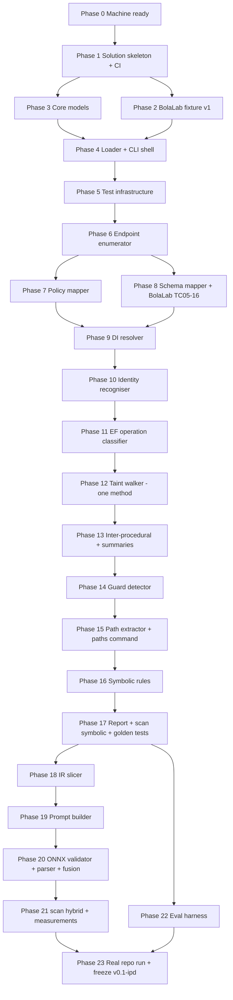

# 11 — Build Flow: the .NET solution from zero to IPD, step by step

This is the **ordered build list**. Do the phases top to bottom; inside a phase do the steps in order. Every step names the file(s) to create, what goes in them, and how you know it is done. Each phase ends with a **checkpoint** (a command + expected result) and a commit.

- Code details and skeletons → `05_IMPLEMENTATION_GUIDE.md` (§ refs given).
- Folder layout and records → `04_SOLUTION_ARCHITECTURE_AND_STRUCTURE.md`.
- Commands for setup → `03_ENVIRONMENT_SETUP_GUIDE.md`.
- BolaLab code → `06_TEST_FIXTURES_BOLALAB.md`.

**Golden rule for every step:** write a small test → make it pass → commit. Never build three components and test later.

---

## The big picture (dependency order)



| Phase | Sprint | Target finish |
|---|---|---|
| 0–2 | S0 | Sun 22 Nov |
| 3–5 | S0 | Sun 29 Nov |
| 6–8 | S1 | Sun 13 Dec |
| 9–15 | S2 | Sun 27 Dec |
| 16–19 | S3 | Sun 10 Jan |
| 20–23 | S4 | Wed 20 Jan |

---

## Phase 0 — Machine ready (≈ 2 h)

| # | Do | Done when |
|---|---|---|
| 0.1 | Install .NET 10 SDK | `dotnet --list-sdks` shows `10.0.x` |
| 0.2 | Install IDE (Visual Studio with ASP.NET workload, or Rider, or VS Code + C# Dev Kit) | You can create and debug a console app |
| 0.3 | Install Git (+ GitHub CLI optional) | `git --version` works; `gh auth status` logged in |
| 0.4 | Install Python 3.11+ (only for model download later) | `python --version` |
| 0.5 | Create private GitHub repo `bolalens` and clone it | Local folder `bolalens/` with `.git` |
| 0.6 | Create `docs/` with `ai-log.md`, `weekly-log.md`, `thesis-notes.md` | First AI-log line written |

---

## Phase 1 — Solution skeleton + CI (≈ 4 h) → `03` §4–§6

| # | Create | What goes in it | Done when |
|---|---|---|---|
| 1.1 | `global.json` | SDK 10.0.100, `rollForward: latestFeature` | `dotnet --version` inside repo shows 10.0.x |
| 1.2 | `BolaLens.sln` | `dotnet new sln -n BolaLens --format sln` | File exists |
| 1.3 | 7 source projects | `BolaLens.Core`, `.Analysis`, `.Slicing`, `.Inference`, `.Reporting`, `.Eval` (classlib), `.Cli` (console) | All in `src/` |
| 1.4 | 3 test projects | `BolaLens.Analysis.Tests`, `.Integration.Tests`, `.Inference.Tests` (xunit v3) | All in `tests/` |
| 1.5 | Project references | Everything → Core; Cli → all; tests → what they test (`03` §4.6) | `dotnet build` succeeds |
| 1.6 | `Directory.Build.props` | net10.0, nullable, implicit usings, deterministic, version 0.1.0 | Removed duplicate props from csproj files |
| 1.7 | `Directory.Packages.props` | `ManagePackageVersionsCentrally=true` | File exists |
| 1.8 | NuGet packages | Run the `dotnet add package` list in `03` §5.3 | Versions appear in `Directory.Packages.props`; all `Microsoft.CodeAnalysis.*` on one version |
| 1.9 | `FrameworkReference Microsoft.AspNetCore.App` in Analysis.Tests | Lets test snippets use `ControllerBase` | Builds |
| 1.10 | `.gitignore`, `.editorconfig` | `dotnet new gitignore/editorconfig` + model/eval ignores | `models/` ignored |
| 1.11 | Delete `Class1.cs`; one trivial test per test project | `Assert.True(true)` placeholders | `dotnet test` green |
| 1.12 | `fixtures/Directory.Build.props` + `fixtures/Directory.Packages.props` | Stop inheritance (`03` §5.6) | — |
| 1.13 | `.github/workflows/ci.yml` | Build tool + test (scan step commented out for now) | Green tick on GitHub |
| 1.14 | `README.md` | Title, one-paragraph description, CI badge, "how to build" | Visible on GitHub |

**Checkpoint 1**
```bash
dotnet build BolaLens.sln && dotnet test BolaLens.sln
```
→ Build succeeded, 3 tests passed, CI green.
Commit: `chore: scaffold BolaLens solution (net10.0) with central packages and CI`

---

## Phase 2 — BolaLab fixture v1 (≈ 4 h) → `06` §1–§4

| # | Create (in `fixtures/BolaLab/src/BolaLab.Api/`) | What goes in it | Done when |
|---|---|---|---|
| 2.1 | Project | `dotnet new webapi --use-controllers`, own `BolaLab.sln`, add Sqlite + JwtBearer packages | Template builds |
| 2.2 | `Domain/Entities.cs` | Order, Project, Note, Document, DocumentShare, Invoice | — |
| 2.3 | `Infrastructure/CurrentUser.cs` | `ICurrentUser` + `HttpCurrentUser` | — |
| 2.4 | `Data/AppDbContext.cs` | DbSets + tenant `HasQueryFilter` on Project and Note | — |
| 2.5 | `Authorization/DocumentEdit.cs` | Requirement + resource handler | — |
| 2.6 | `Contracts/Requests.cs` | Request records | — |
| 2.7 | `Program.cs` (replace template) | DI, JWT, fallback policy, DocumentEdit policy, service registrations | — |
| 2.8 | `Services/*.cs` | Invoice repo/service, order processors (needed so Program.cs compiles) | — |
| 2.9 | `Controllers/OrdersController.cs` with **TC01–TC04 only** for now | UpdateStatus, Update, Delete, CopyStatus | — |
| 2.10 | `fixtures/BolaLab/expected.json` | First 4 entries | Valid JSON |
| 2.11 | `fixtures/BolaLab/README.md` | "Deliberately vulnerable – never deploy" | — |

**Checkpoint 2**
```bash
dotnet build fixtures/BolaLab/BolaLab.sln
```
→ 0 errors. Then uncomment the fixture build step in CI.
Commit: `test(bolalab): add vulnerable fixture API with TC01-TC04`

---

## Phase 3 — Core models (≈ 4 h) → `04` §5

All files in `src/BolaLens.Core/`. No Roslyn references here.

| # | File | Contents | Test |
|---|---|---|---|
| 3.1 | `Model/SourceRef.cs`, `Model/UnresolvedItem.cs` | Location record; reason + optional location | — |
| 3.2 | `Model/EndpointInfo.cs` | `HttpVerb`, `BindingSource`, `ParameterInfo`, `AuthorizeInfo`, `EndpointInfo` | Round-trip JSON |
| 3.3 | `Model/PolicyMap.cs` | `PolicyDefinition`, `ResourceHandlerInfo`, `PolicyMap` | Round-trip JSON |
| 3.4 | `Model/OwnershipSchema.cs` | `OwnerKind`, `OwnerEvidence`, `OwnerCandidate`, `QueryFilterInfo`, `EntityModel`, `OwnershipSchema` | Round-trip JSON |
| 3.5 | `Model/ExecutionPath.cs` | `StepKind`, `PathStep`, `SinkKind`, `SinkInfo`, `GuardKind`, `GuardEvidence`, `ExecutionPath` | Round-trip JSON |
| 3.6 | `Model/Verdicts.cs`, `Model/Finding.cs`, `Model/ScanReport.cs` | `VerdictStatus`, `SymbolicVerdict`, `SemanticVerdict`, `Finding`, `CoverageManifest`, `RunInfo`, `ScanReport` | Round-trip JSON |
| 3.7 | `Json/JsonDefaults.cs` | `JsonSerializerOptions`: camelCase, `JsonStringEnumConverter`, indented, ignore nulls | Enums serialise as strings |
| 3.8 | `Config/BolaLensConfig.cs` + `Config/ConfigLoader.cs` | Classes matching `bolalens.json` (`04` §7); built-in defaults; load + merge from file; `ComputeHash()` (SHA-256 of normalised JSON) | Missing file → defaults; partial file overrides only given keys |
| 3.9 | `Abstractions/ISemanticValidator.cs` | `Task<SemanticVerdict> ValidateAsync(IrSliceText slice, CancellationToken ct)` where `IrSliceText` = text + valid line IDs (record in Core so Inference doesn't depend on Slicing) | Compiles |
| 3.10 | `bolalens.json` at repo root | Default config (copy of `04` §7) | Loads in test |

Where to put the tests: create `tests/BolaLens.Analysis.Tests/Core/ModelSerializationTests.cs` (it already references Core).

**Checkpoint 3** → `dotnet test` green with ~8 new tests.
Commit: `feat(core): domain records, JSON defaults and configuration loader`

---

## Phase 4 — Loader + CLI shell (≈ 5 h) → `05` §2, §18

| # | File | What to implement | Done when |
|---|---|---|---|
| 4.1 | `Analysis/Loading/MsBuildBootstrap.cs` | `EnsureRegistered()` with lock + `MSBuildLocator.RegisterDefaults()` | — |
| 4.2 | `Analysis/Loading/LoadedSolution.cs` | Holds workspace, solution, root dir, diagnostics; `IDisposable` | — |
| 4.3 | `Analysis/Loading/WorkspaceLoader.cs` | Open `.sln/.slnx/.csproj`; capture workspace failures; de-duplicate multi-target projects by file path | — |
| 4.4 | `Analysis/Common/SourceRefs.cs` | `From(Location, root)`, `From(SyntaxNode, root)` → relative path + 1-based lines | Unit test with a snippet |
| 4.5 | `Analysis/Common/SemanticModelCache.cs` | `Dictionary<SyntaxTree, SemanticModel>`; `GetAsync(solution, tree)` via `solution.GetDocument(tree)` | — |
| 4.6 | `Analysis/Common/SymbolNames.cs` | String-based type checks that work **across compilations**: `Is(type, "Microsoft.AspNetCore.Mvc.ControllerBase")`, `InheritsFrom(type, fullName)`, `NamespaceStartsWith(symbol, "Microsoft.EntityFrameworkCore")`, `IsGeneric(type, "Microsoft.EntityFrameworkCore.DbSet", 1)` | Unit tests |
| 4.7 | `Analysis/Pipeline/AnalysisContext.cs` | One object passed through Stage 1: `Solution`, `RootDirectory`, `Config`, `SemanticModelCache`, `CancellationToken`, and later `PolicyMap`, `SchemaIndex`, `DiRegistrationMap` | — |
| 4.8 | `Cli/Program.cs` | First line `MsBuildBootstrap.EnsureRegistered()`; `RootCommand`; register subcommands; `return await root.Parse(args).InvokeAsync();` | `bolalens --help` prints |
| 4.9 | `Cli/Commands/CommandHelpers.cs` | Shared options (`path` argument, `--out`, `--config`, `--verbose`), JSON writing to file or stdout, exit codes (0 / 1 / 2) | — |
| 4.10 | `Cli/Commands/InventoryCommand.cs` | Load → for each project print name, path, document count, compile error count; print workspace diagnostics | Works on BolaLab |
| 4.11 | `Integration.Tests/Infrastructure/TestBootstrap.cs` | `[ModuleInitializer] internal static void Init() => MsBuildBootstrap.EnsureRegistered();` | — |
| 4.12 | `Integration.Tests/Infrastructure/RepoPaths.cs` | Walk up from `AppContext.BaseDirectory` until `BolaLens.sln` (or `.slnx`) is found; expose `BolaLabSln` | — |
| 4.13 | `Integration.Tests/LoaderTests.cs` | BolaLab loads; documents > 0; compile errors == 0; missing path throws | Green |

Why `SymbolNames` (4.6) matters: the same ASP.NET/EF type seen from two projects can be two different symbol objects. Comparing full names avoids "it works in tests but not on a multi-project repo" bugs. Use `SymbolEqualityComparer.Default` only for symbols from the *same* compilation (locals, parameters, methods you just resolved).

**Checkpoint 4**
```bash
dotnet run --project src/BolaLens.Cli -- inventory fixtures/BolaLab/BolaLab.sln
```
→ `BolaLab.Api  documents: N  errors: 0`
Commit: `feat(loading): MSBuild workspace loader and inventory command`

🎯 **Sprint 0 milestone reached.**

---

## Phase 5 — Test infrastructure (≈ 2 h) → `05` §12

| # | File | What | Done when |
|---|---|---|---|
| 5.1 | `Analysis.Tests/Infrastructure/CompilationFactory.cs` | `Create(params string[] sources) → Solution` (AdhocWorkspace + trusted-platform references); `AssertCompilesAsync` | A snippet with `ControllerBase` + `DbContext` compiles |
| 5.2 | `Analysis.Tests/Infrastructure/Snippets.cs` | Reusable C# strings: minimal entity + DbContext, minimal controller, `ICurrentUser` — so each test adds only the lines it cares about | — |
| 5.3 | `Analysis.Tests/Infrastructure/TestContext.cs` | `Task<AnalysisContext> FromSnippetsAsync(...)` building the context with default config | Used by later tests |
| 5.4 | `Integration.Tests/Infrastructure/BolaLabFixture.cs` | xUnit class fixture that loads BolaLab **once** for all integration tests | Load time paid once |

**Checkpoint 5** → a test `Snippets_compile()` passes.
Commit: `test: in-memory compilation factory and BolaLab fixture`

---

## Phase 6 — Endpoint enumerator (≈ 7 h) → `05` §3

| # | File (`Analysis/Endpoints/`) | What to implement | Test |
|---|---|---|---|
| 6.1 | `RouteTemplate.cs` | `Combine(classTemplate, methodTemplate)`, `[controller]`/`[action]` replacement, absolute `/`/`~/` handling, `Normalise()` (lower-case, strip constraints `{id:int}`→`{id}`, trim `/`), `Parameters()` (names in braces) | 6+ pure string tests |
| 6.2 | `AttributeReader.cs` | Read `[Route]`, `[Http*]` (verb + template), `[Authorize]` (Policy, Roles), `[AllowAnonymous]`, `[From*]` from `AttributeData` | — |
| 6.3 | `BindingInference.cs` | Explicit `[From*]` → else in template → Route; simple type → Query; complex → Body; `[FromServices]`/interfaces → Service | Route/Query/Body cases |
| 6.4 | `IdLikeDetector.cs` | Name patterns from config; types int/long/Guid/string; for Body DTOs inspect properties → `IdPropertyPath` | `request.OrderId` found |
| 6.5 | `EndpointEnumerator.cs` | Walk source types; keep controllers (inherit `ControllerBase`, not abstract); public instance methods with `[Http*]`; build `EndpointInfo` with `SourceRef` | Snippet with 2 actions → 2 endpoints |
| 6.6 | `Cli/Commands/EndpointsCommand.cs` | `bolalens endpoints <path> [--out]` | — |
| 6.7 | `Integration.Tests/EndpointsOnBolaLabTests.cs` | BolaLab endpoints = the TC actions present; verbs/routes match `expected.json` | Green |

**Checkpoint 6** → `bolalens endpoints fixtures/BolaLab/BolaLab.sln` prints 4 endpoints with correct routes and `id` marked route + id-like.
Commit: `feat(endpoints): controller endpoint inventory with binding and auth metadata`

---

## Phase 7 — Global policy mapper (≈ 5 h) → `05` §4

| # | File (`Analysis/Policy/`) | What | Test |
|---|---|---|---|
| 7.1 | `InvocationScanner.cs` (in `Common/`) | Helper: enumerate all `IInvocationOperation`s in the solution (per document: syntax `InvocationExpressionSyntax` → `model.GetOperation`) — reused by DI and schema phases | — |
| 7.2 | `AuthenticationReader.cs` | `AddAuthentication` default scheme, `AddJwtBearer`/`AddCookie`/… | JWT detected |
| 7.3 | `AuthorizationReader.cs` | `AddAuthorization(o => …)` assignments + `AddPolicy`; `AddAuthorizationBuilder()` chain (`AddPolicy`, `SetFallbackPolicy`, `SetDefaultPolicy`); `RequireAuthenticatedUser` detection; `MapControllers().RequireAuthorization()`; global `AuthorizeFilter` | Both styles |
| 7.4 | `ResourceHandlerReader.cs` | Classes whose base is `AuthorizationHandler<TReq, TRes>` → `ResourceHandlerInfo` | DocumentEditHandler found |
| 7.5 | `GlobalPolicyMapper.cs` | Combine readers → `PolicyMap`; anything dynamic → `Unresolved` | — |
| 7.6 | `Cli/Commands/PolicyCommand.cs` | `bolalens policy <path>` | — |

**Checkpoint 7** → BolaLab policy: scheme JwtBearer, fallback = authenticated, policy `DocumentEdit`, handler `DocumentEditHandler` (resource `Document`).
Commit: `feat(policy): global authentication/authorization policy map`

---

## Phase 8 — Ownership schema mapper + finish BolaLab (≈ 9 h) → `05` §5, `06` §4–§6

| # | File | What | Test |
|---|---|---|---|
| 8.1 | `Analysis/Schema/DbContextLocator.cs` | Source classes inheriting `Microsoft.EntityFrameworkCore.DbContext`; their `DbSet<T>` properties → entity types | 1 context, 6 entities on BolaLab |
| 8.2 | `Analysis/Schema/KeyInference.cs` | `Id`, `{Type}Id`, `[Key]`, `HasKey` | — |
| 8.3 | `Analysis/Schema/OwnerCandidateInference.cs` | Name patterns (User/Tenant) + navigation/FK to user types | Order: UserId(User), TenantId(Tenant) |
| 8.4 | `Analysis/Schema/QueryFilterExtractor.cs` | Every `HasQueryFilter` invocation → entity from `EntityTypeBuilder<T>`; lambda → referenced entity properties; scope kind | Project + Note filters |
| 8.5 | `Analysis/Schema/DbContextSchemaMapper.cs` | Builds `OwnershipSchema` (Core, strings) **and** `SchemaIndex` (Analysis-internal: entity type full name → `EntityModel`, plus `RequiredOwnerKind(entity)`) | Table in `06` §7 matches |
| 8.6 | `Cli/Commands/SchemaCommand.cs` | `bolalens schema <path>` | — |
| 8.7 | **BolaLab: add TC05–TC16** | Rest of `OrdersController`, `ProjectsController`, `NotesController`, `DocumentsController`, `InvoicesController` | Builds |
| 8.8 | `expected.json` complete (16) + `Integration.Tests/ExpectedJsonTests.cs` | 16 unique units; every unit matches an enumerated endpoint | Green |
| 8.9 | (doc track) stakeholder onion draft | `08` §1 | — |

**Checkpoint 8**
```bash
bolalens endpoints fixtures/BolaLab/BolaLab.sln   # 16 endpoints
bolalens schema    fixtures/BolaLab/BolaLab.sln   # matches 06 §7
```
Commit: `feat(schema): EF Core ownership schema and query filters` + `test(bolalab): TC05-TC16`

🎯 **Sprint 1 milestone reached.**

---

## Phase 9 — DI registration map + implementation resolver (≈ 5 h) → `05` §6

| # | File (`Analysis/DI/`) | What | Test |
|---|---|---|---|
| 9.1 | `DiRegistrationMap.cs` | Collect `AddScoped/AddTransient/AddSingleton` (generic + `typeof`) using `InvocationScanner` | BolaLab map = `06` §7 |
| 9.2 | `ImplementationResolver.cs` | `ResolveAsync(IMethodSymbol) → ResolvedTarget { Method?, Unresolved? }`: source body → use; interface → DI map → `FindImplementationForInterfaceMember`; fallback `SymbolFinder.FindImplementationsAsync`; 0 / >1 → Unresolved with reason | `IInvoiceService.VoidAsync` → `InvoiceService.VoidAsync`; `IOrderProcessor.ProcessAsync` → ambiguous |
| 9.3 | `MethodBodyProvider.cs` | From `IMethodSymbol` → syntax → semantic model → `IMethodBodyOperation` (cached) | — |

Checkpoint 9 → resolver tests green. Commit: `feat(di): DI registration map and implementation resolver`

---

## Phase 10 — Caller-identity recogniser (≈ 3 h) → `05` §7

| # | File | What | Test |
|---|---|---|---|
| 10.1 | `Analysis/Taint/CallerIdentityRecognizer.cs` | `TryGetIdentityKind(IOperation, TaintState) → OwnerKind?`: `User`, `HttpContext.User`, `FindFirst/FindFirstValue`, configured `ICurrentUser.UserId/TenantId`, extension methods, conversions/parse, identity locals | `currentUser.UserId` → User; `currentUser.TenantId` → Tenant; `request.UserId` → null |

Commit: `feat(taint): trusted caller identity recogniser`

---

## Phase 11 — EF Core operation classifier (≈ 4 h) → `05` §9

| # | File | What | Test |
|---|---|---|---|
| 11.1 | `Analysis/Sinks/EfOperationKind.cs` | Enum: Load, Chain, Bypass, Write, EntryState, Commit, Bulk, Create, None | — |
| 11.2 | `Analysis/Sinks/EfOperationClassifier.cs` | `Classify(IInvocationOperation)` by resolved method name + namespace (`Microsoft.EntityFrameworkCore*` or `System.Linq.Queryable` on an EF root) | One test per row of the `05` §9 table |
| 11.3 | `Analysis/Sinks/QueryChainAnalyzer.cs` | Walk receiver chain (`Instance` or `Arguments[0]` for extensions) → root entity type, predicates (lambdas), `IgnoreQueryFilters` flag | `Where(...).ExecuteDeleteAsync()` → entity Order, 1 predicate |

Commit: `feat(sinks): EF Core operation classifier and query-chain analysis`

---

## Phase 12 — Taint walker, single method (≈ 6 h) → `05` §8.1–§8.3

| # | File (`Analysis/Taint/`) | What | Test |
|---|---|---|---|
| 12.1 | `TaintState.cs`, `EntityRef.cs` | Tainted / Identity / Selected sets (SymbolEqualityComparer) | — |
| 12.2 | `TaintExpressions.cs` | `IsTainted(op)`, unwrap helpers (await, conversion, coalesce, parenthesis) | Parameter, local, `dto.OrderId`, `int.Parse(x)` |
| 12.3 | `EntityLoadRecognizer.cs` | `TryEntityLoad(op, state, out EntityRef)` using `QueryChainAnalyzer`; key match with tainted value; owner predicate with identity; detached `new T { Id = tainted }` | TC01 load, TC08 detached, TC12 owner predicate |
| 12.4 | `TaintWalker.cs` (intra only) | `OperationWalker` handling declarators, assignments (incl. mutation of selected entity), EF invocations (record sinks), returns; collects `PathStep`s in order | TC01 in a snippet → Load, Mutation, Commit steps |

Commit: `feat(taint): intra-procedural taint walker`

---

## Phase 13 — Inter-procedural propagation + summaries (≈ 5 h) → `05` §8.4

| # | File | What | Test |
|---|---|---|---|
| 13.1 | `Analysis/Taint/MethodSummary.cs` + `SummaryKey` | (method, tainted/selected/identity parameter masks) → summary | — |
| 13.2 | `Analysis/Taint/InterproceduralAnalyzer.cs` | `Analyse(method, masks, depth)`; arg → param mapping via `IArgumentOperation.Parameter.Ordinal`; depth limit → Unresolved; cache | — |
| 13.3 | Commit summary | For calls with **no** relevant args, cached "does callee call SaveChanges?" → Commit step | TC13 save in repository detected |
| 13.4 | Wire into `TaintWalker` | Call `InterproceduralAnalyzer` when a source/interface method receives tainted/selected/identity values; propagate `ReturnsEntity`/`ReturnsTainted` to the assigned local | TC13: entity returned from repo, mutated in service, saved in repo |

Commit: `feat(taint): inter-procedural propagation with method summaries`

---

## Phase 14 — Guard detector (≈ 5 h) → `05` §10

| # | File (`Analysis/Guards/`) | What | Test |
|---|---|---|---|
| 14.1 | `ConditionAnalyzer.cs` | Find owner-vs-identity comparisons inside any condition (`==`, `!=`, `!`, `\|\|`, `&&`, `string.Equals`, `.Equals`) | TC02, TC14, TC16 forms |
| 14.2 | `ExitBranchDetector.cs` | Does a branch return/throw (`Forbid`, `NotFound`, `Unauthorized`, `throw`)? | — |
| 14.3 | `GuardDetector.cs` | Build `GuardEvidence` (OwnerEquality / LinqOwnerPredicate / ResourceAuthorization); validity: trusted comparand, same object as sink, precedes sink, owner kind matches; record invalid reasons | TC03 untrusted, TC04 different object, TC05 after sink, TC09 resource authz |
| 14.4 | Wire into `TaintWalker` (`VisitConditional`, `AuthorizeAsync` invocations) | Guards appear in steps and in the summary | — |

Commit: `feat(guards): owner guard detection with binding validation`

---

## Phase 15 — Path extractor + `paths` command (≈ 3 h)

| # | File | What | Test |
|---|---|---|---|
| 15.1 | `Analysis/Taint/PathExtractor.cs` | For each endpoint × id-like param: seed taint, run analysis, build `ExecutionPath` (stable id = hash(endpoint id + param)); sinks get `QueryFilter` facts from `SchemaIndex` | 16+ paths on BolaLab |
| 15.2 | `Cli/Commands/PathsCommand.cs` | `bolalens paths <path> [--endpoint "VERB route"]` | — |
| 15.3 | `Integration.Tests/PathsSnapshotTests.cs` | Verify snapshot of BolaLab `paths.json` (review the first snapshot line by line!) | Snapshot approved |

**Checkpoint 15**
```bash
bolalens paths fixtures/BolaLab/BolaLab.sln --endpoint "DELETE api/invoices/{id}"
```
→ steps: Source → Call InvoicesController.Void → Call InvoiceService.VoidAsync → Load (repo `FindAsync`) → Mutation `IsVoid` → Commit (repo `SaveChangesAsync`); guards: none.
Commit: `feat(paths): execution path extraction and paths command`

🎯 **Sprint 2 milestone reached.**

---

## Phase 16 — Symbolic rules (≈ 4 h) → `05` §11

| # | File (`Analysis/Verdict/`) | What | Test |
|---|---|---|---|
| 16.1 | `SymbolicRules.cs` | One method per rule SYM-01…SYM-09 returning `bool` + rationale text | One minimal test per rule |
| 16.2 | `SymbolicClassifier.cs` | Apply rules in the fixed order; return `SymbolicVerdict` with rule ID | — |
| 16.3 | `EndpointAggregator.cs` | Endpoint status = worst of its paths (Vulnerable > Unknown > Protected > OutOfScope) | TC04 → Vulnerable |
| 16.4 | `Analysis/Pipeline/SymbolicPipeline.cs` | Load-independent orchestration: endpoints → policy → schema → DI → paths → verdicts; per-phase `Stopwatch` timings | — |

Commit: `feat(verdict): symbolic rules SYM-01..09 and pipeline`

---

## Phase 17 — Reporting + `scan --mode symbolic` + golden tests (≈ 5 h)

| # | File | What | Test |
|---|---|---|---|
| 17.1 | `Reporting/FindingIdFactory.cs` | SHA-256 of `verb|route|sinkSymbol|sinkLine` → first 12 hex chars | Stable across runs |
| 17.2 | `Reporting/CoverageManifestBuilder.cs` | Counts for the manifest (projects, endpoints, paths, truncated, unresolved, verdict counts) | — |
| 17.3 | `Reporting/RunInfoBuilder.cs` | Tool version, mode, target, git commit of target (read `.git/HEAD` if present), config hash, timings, `PeakWorkingSet64`, machine name | — |
| 17.4 | `Reporting/JsonReportWriter.cs` | Serialize `ScanReport` with `JsonDefaults` | — |
| 17.5 | `Reporting/ConsoleSummaryRenderer.cs` | Table: endpoint · final · rule · reason (Spectre.Console table or plain text) | — |
| 17.6 | `Cli/Commands/ScanCommand.cs` | `--mode symbolic` path: load → SymbolicPipeline → `NullSemanticValidator` → report → exit code | — |
| 17.7 | `Integration.Tests/BolaLabGoldenTests.cs` | `[Theory]` over `expected.json`: status + rule ID per TC | Target ≥ 12/16 |
| 17.8 | `docs/known-limitations.md` | Every golden miss explained | — |
| 17.9 | CI | Uncomment the smoke-scan step; upload `bolalab-report.json` artifact | Artifact visible |

**Checkpoint 17**
```bash
bolalens scan fixtures/BolaLab/BolaLab.sln --mode symbolic --out report.json
```
→ console table of 16 endpoints; exit code 1 (vulnerabilities present); golden tests mostly green.
Commit: `feat(report): JSON report, console summary and symbolic scan`

---

## Phase 18 — IR slicer (≈ 5 h) → `05` §13

| # | File (`Slicing/`) | What | Test |
|---|---|---|---|
| 18.1 | `CommentStripper.cs` | `CSharpSyntaxRewriter` removing comment/doc trivia | TC16 comment gone |
| 18.2 | `StatementText.cs` | Statement containing a step → normalised one-line text; shorten long string literals | — |
| 18.3 | `IrSlice.cs`, `SourceMap.cs` | Lines `L1..Ln` with tag, text, `SourceRef`; `ToText()`; `ValidLineIds` | — |
| 18.4 | `IrSliceGenerator.cs` | Build lines from path (ENDPOINT, POLICY, SOURCE, CALLER, CALL, LOAD, SCHEMA, CHECK, MUTATE, SINK, UNRESOLVED); provenance facts; **no verdicts** | Snapshot for TC01 + TC13 |
| 18.5 | `TokenEstimator.cs` | chars/4 estimate (replace with real tokenizer count when the model is loaded); truncate over budget with `[TRUNCATED n]` | — |
| 18.6 | `Cli/Commands/SliceCommand.cs` | `bolalens slice <path> --endpoint …` | — |

Commit: `feat(slicing): label-free IR slices with source map`

---

## Phase 19 — Prompt builder (≈ 3 h) → `05` §15, `06` §8

| # | File | What | Done when |
|---|---|---|---|
| 19.1 | `fixtures/Calibration/` | 3 tiny examples in a different domain + their slices + hand-written ideal answers (`calibration.json`) | Not overlapping BolaLab |
| 19.2 | `Slicing/Prompting/prompt-v1.txt` (EmbeddedResource) | Template with `{examples}` and `{slice}` placeholders | — |
| 19.3 | `Slicing/Prompting/PromptBuilder.cs` | Fill template; `PromptVersion` + SHA-256 | Test: output contains slice, no "TC" strings |
| 19.4 | `--prompt` flag on `slice` command | Print the full prompt | — |

Commit: `feat(prompt): prompt v1 with calibration few-shot examples`

🎯 **Sprint 3 milestone reached** (ONNX spike in Phase 20.1–20.2 may start here).

---

## Phase 20 — Local SLM: generator, parser, validator, fusion (≈ 7 h) → `05` §14, §16

| # | File | What | Test |
|---|---|---|---|
| 20.1 | Download model + hashes (`03` §7); `models/README.md` | Phi-3-mini-4k int4 CPU | Hash table written |
| 20.2 | `Inference/OnnxTextGenerator.cs` | Load once; greedy; early stop at end of JSON; return text + token counts | `[Trait("Category","RequiresModel")]` smoke test |
| 20.3 | `Inference/SemanticResponseParser.cs` | Extract first JSON object; schema checks; evidence grounding against `ValidLineIds`; ungrounded → Unknown | 8+ tests with hand-written good/bad outputs (no model needed) |
| 20.4 | `Inference/OnnxSemanticValidator.cs` | Prompt → generate → parse → retry once → `SemanticVerdict` (latency, model id) | RequiresModel test on TC01 slice |
| 20.5 | `Inference/NullSemanticValidator.cs` | Returns "not invoked" | — |
| 20.6 | `Inference/FusionPolicy.cs` | Table from `05` §16 with threshold τ from config | One test per table row |
| 20.7 | `Inference/CandidateSelector.cs` | Which paths go to the SLM (Vulnerable, Unknown, SYM-05 Protected) | — |

Commit: `feat(inference): local ONNX validator, grounded parser and fusion policy`

---

## Phase 21 — `scan --mode hybrid` + measurements (≈ 3 h)

| # | Where | What | Done when |
|---|---|---|---|
| 21.1 | `ScanCommand` | Hybrid branch: model load timed separately; per-candidate slice → validate → fuse; progress output | Runs on BolaLab |
| 21.2 | `RunInfo` | `ModelId`, `ModelSha256`, `PromptVersion`, `ModelLoadSeconds`, per-phase times, peak memory | Present in report |
| 21.3 | `eval/runs/<date>-bolalab-{symbolic,hybrid}/` | 3 repetitions each; `env.md` with hardware | Files committed (raw outputs git-ignored) |
| 21.4 | Offline proof | Network off → hybrid scan → screenshot/recording | Evidence saved in `docs/ipd/` |

Commit: `feat(scan): hybrid mode with timing and memory metrics`

---

## Phase 22 — Evaluation harness (≈ 4 h) → `05` §17

| # | File (`Eval/`) | What | Test |
|---|---|---|---|
| 22.1 | `LabelSet.cs` | Load `expected.json` (fixtures) and `*.labels.json` (datasets) into one model | — |
| 22.2 | `UnitMatcher.cs` | Normalised `VERB route` (+ entity) matching; unmatched predictions/labels listed | — |
| 22.3 | `ConfusionMatrix.cs` | TP/FP/FN/TN + Unknown on vulnerable / protected; excluded labels | Hand-computed example |
| 22.4 | `Metrics.cs` | Precision, recall, operational recall, F1, FPR, FDR, coverage; `null` when denominator is 0 | Divide-by-zero tests |
| 22.5 | `MarkdownTable.cs` | Pretty table (n/a for null) | — |
| 22.6 | `Cli/Commands/EvalCommand.cs` | `bolalens eval --report r.json --labels l.json [--compare r2.json] [--out metrics.md]` | Symbolic vs hybrid side by side |

**Checkpoint 22** → `metrics.md` for BolaLab symbolic vs hybrid (your preliminary-results slide).
Commit: `feat(eval): evaluation harness with confusion matrix and metrics`

---

## Phase 23 — Real repo, polish, freeze (≈ 6 h)

| # | Do | Done when |
|---|---|---|
| 23.1 | Clone best Dataset B candidate at a pinned SHA; `dotnet restore`; `bolalens inventory` | Errors recorded |
| 23.2 | `scan --mode symbolic` then `--mode hybrid`; record runtime, memory, coverage, Unknowns | Run folder in `eval/runs/` |
| 23.3 | Exploratory labels on ~10 endpoints (marked *exploratory*) | File in `eval/labels/exploratory/` |
| 23.4 | README: install, build, model download, every command with an example, architecture diagram, limitations | Tested on a fresh clone |
| 23.5 | Fill FR/NFR status columns from real code (`08`) | — |
| 23.6 | `git tag v0.1-ipd && git push --tags`; release notes | Tag on GitHub |
| 23.7 | Demo dry-run from the tag (`09` §4) | Under 8 minutes |

🎯 **Code freeze — Wed 20 Jan.** Then Sprint 5 = slides and submission.

---

## After the IPD (for completeness)

| Phase | What | Files |
|---|---|---|
| 24 | Control-flow dominance for guards | `Guards/DominanceAnalyzer.cs` using `ControlFlowGraph.Create` |
| 25 | Extract guard helper methods (`EnsureOwner(order)`) via summaries | `Guards/GuardSummary.cs` |
| 26 | Minimal-API endpoints (`MapPut` etc.) | `Endpoints/MinimalApiEnumerator.cs` |
| 27 | SARIF 2.1.0 output + GitHub code scanning upload | `Reporting/Sarif/SarifReportWriter.cs`, workflow step |
| 28 | Reusable GitHub Action | `.github/actions/bolalens/action.yml` |
| 29 | HTML report (or minimal React view) | `Reporting/Html/` |
| 30 | Robustness runner (renames, misleading comments kept, equivalent guards) | `Eval/Perturbations/` |
| 31 | Model comparison runner (same slices, several models) | `Eval/ModelComparison.cs` |
| 32 | Full experiments on frozen A/B/C | `eval/runs/final-*` |

---

## Quick self-check: "Can I explain it?" (do this at the end of each phase)

For the classes you wrote in the phase, answer out loud in under a minute each:
1. What does it take in and give back?
2. Which Roslyn API does the real work?
3. What case does it get wrong (its known limitation)?
4. Which test proves it works?

If you can't, the examiner will notice in Q&A — fix the understanding before moving on.
